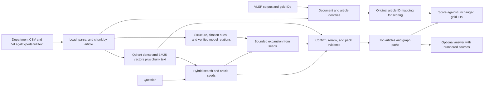

# Vietnamese Legal GraphRAG thesis and experiment guide

## 1. The research question and the results to lead with

The project asks when following relationships between Vietnamese legal articles helps a retriever find the evidence needed for a question. The main comparison is with hybrid search that combines dense BGE-M3 embeddings and lexical BM25 rankings. There are three related research questions.

| Research question | Strongest evidence in this repository |
| --- | --- |
| Can a graph follow an explicit citation across documents? | On 107 held-out citation tasks, graph retrieval returned both articles in **105/107** cases, hybrid given the citation wording and target-law filter did so in **83/107**, and exact article lookup did so in **107/107**. [Citation report](../reports/reference_follow_20261121.md) |
| Does expansion help on naturally worded questions? | On 400 fully mapped natural questions, graph Recall@10 was **92.46%**, default hybrid **89.96%**, and tuned hybrid **91.27%**. The paired interval for the **+1.19 percentage point** gain over tuned hybrid spans zero. [Natural-question report](../reports/natural_graph_20261121.md) |
| Does the relation extraction model make a difference? | On 165 controlled article pairs, quote-validated macro-F1 over three primary relation types was **33.87%** for local Gemma 4 and **100.00%** for GPT-6-Luna via OpenRouter. On a separate retrieval replay reusing 29 of the source–target pairs, both enriched graphs recovered both articles at rank 10 in **29/29** cases. [Model comparison](../reports/relation_model_comparison_20261121.md) |

For the thesis, work through the [architecture](#2-how-the-system-works), [metrics](#3-how-to-read-the-metrics), and [experiment history](#4-experiments-in-order). The [reproduction instructions](#5-how-to-reproduce-the-results) start with archived predictions and continue through live rebuilds. The [writing and defense section](#6-writing-the-thesis-and-reporting-it) maps the evidence to chapters and slides.

## 2. How the system works

### From Vietnamese legal documents to retrievable evidence



1. **Filter the source corpus.** Read the 2,157 distinct `law_id` values in VLSP `corpus.csv`. Compare each to the complete `Số hiệu` field of a department CSV row or the corresponding number from ViLegalExperts metadata or context header. This first filter uses exact number equality after the prescribed header whitespace trim. It preserves duplicates and therefore also preserves possible conflicts across issuers and versions. The saved subset covers **1,869/2,157** law identifiers, with **288** missing local full text. It contains **2,051 source records** across **1,969 department rows** and **82 context files**. The department source `ID` identifies a record independently of the law number. [Data inventory](../data/README.md) · [Source-filter counts](../data/summary.json) · [Filter implementation](../data/build.py)
2. **Parse and chunk the source text.** The 14-column UTF-8 CSV loader streams rows and tolerates large multiline `Toàn văn` values. It carries title, `Số hiệu`, issuing body, sector, field, signer, and status/date metadata into the stores. The provision parser identifies `Chương` (chapter), `Điều` (article), `Khoản` (clause), and `Điểm` (point). The chunker uses article boundaries before splitting long sections into overlapping windows. Its default limit is 1,800 characters, with 250 characters of overlap. Source metadata headers can be present in indexed chunk text. Flattened headings and repeated article numbers require careful parsing. The repaired snapshot chunks each article independently and records its owner explicitly. [CSV loader](../src/legal_graphrag/csv_loader.py) · [Structure parser](../src/legal_graphrag/structure.py) · [Chunker](../src/legal_graphrag/chunking.py)
3. **Track the identifiers.** The document number names the legal instrument. A source document ID identifies the actual ingested record. An internal article ID such as `112405:article:8` names a node, with an occurrence suffix available for repeated headings. A chunk ID identifies one text passage. The original VLSP `aid` is the benchmark identifier. The original IDs in `relevant_aids` for `eval.csv` and `relevant_laws` for `train.csv` refer to articles. In a query result, an article may have several chunks. In evaluation, it contributes once. [Corpus format](../data/README.md) · [Evaluation loader](../src/legal_graphrag/evaluation.py) · [DRiLL task specification](https://vlsp.org.vn/vlsp2025/eval/drill)
4. **Map internal articles to the original `aid` values.** The November 7 pilot reused matching vectors and mapped chunks with an exact containment audit. The repair pipeline requires the entire normalized VLSP article body of at least 30 characters to appear in exactly one parsed source article under the same law number. It rejects many-to-one mappings. Normalization handles Unicode NFC, whitespace, quote typography and missing spaces before uppercase sentence starts. This comparison leaves the archived source evidence and gold labels intact. A similarity suggestion in a mapping review becomes research evidence only after identity is independently resolved. [Snapshot and mapping builder](../scripts/repair_coverage.py) · [Mapping gap audit](../scripts/audit_mapping_gaps.py)

### Search and ranking technologies

| Technology | What to understand and where to see it |
| --- | --- |
| **Dense embeddings and cosine similarity** | BGE-M3 converts query and chunk text into fixed-size vectors. Cosine is the normalized dot product, measuring alignment between query and evidence vectors. Similar vectors can arise from related topics or language even when a law number or exact article differs. Ollama serves the same embedding model to the indexer and query encoder. The repository uses BGE-M3 for the dense channel and a separate model for the sparse channel. [BGE-M3 paper](https://arxiv.org/abs/2402.03216) · [Ollama embedding client](../src/legal_graphrag/llm.py) |
| **BM25 and sparse vectors** | BM25 ranks lexical matches using term frequency with saturation, inverse document frequency (rarer terms carry more weight), and document-length normalization. FastEmbed encodes the named `bm25` field using `Qdrant/bm25`, `avg_len=256.0` and `disable_stemmer=True`. Qdrant applies its IDF modifier. The named `dense` field uses cosine. [BM25 paper](https://www.ccs.neu.edu/home/vip/teach/IRcourse/IR_surveys/robertson_foundations.pdf) · [Indexer](../ingest.py) · [Qdrant storage and queries](../src/legal_graphrag/qdrant_store.py) |
| **Reciprocal Rank Fusion (RRF)** | RRF adds reciprocal rank contributions from the dense and sparse lists. A common expression is `sum(1 / (k + rank))` over lists containing an item. Strong ranks in either list help, and there is no direct comparison of raw BM25 and cosine scores. The live hybrid lookup asks Qdrant to fuse the rankings. The early legacy reranker also uses its own `1 / (60 + rank)` feature after fusion. [RRF paper](https://cormack.uwaterloo.ca/cormack/cormacksigir09-rrf.pdf) · [Qdrant hybrid queries](https://qdrant.tech/documentation/search/hybrid-queries/) · [Reranker](../src/legal_graphrag/retrieval.py) |
| **TF-IDF and n-grams** | The document-pair builder uses scikit-learn TF-IDF with word n-grams of length 1–4 to surface phrases shared by documents. The provision builder uses sparse n-gram and other signals for candidate discovery before verification. The separate `ngram_frequencies.py` explores corpus phrase counts. The question retrieval baseline uses BM25/RRF. [Document relation builder](../src/legal_graphrag/relation_builder.py) · [Provision relation builder](../src/legal_graphrag/semantic.py) · [N-gram utility](../ngram_frequencies.py) |
| **Neo4j and Cypher** | The service and the first article pilot use labeled nodes and directed, typed relationships. The document graph connects records to instruments, agencies, people and metadata. The provision graph stores hierarchy and evidence-bearing edges. Cypher writes use stable identifiers, constraints and `MERGE` so repeated writes can converge on the same nodes and edges. [Graph store](../src/legal_graphrag/graph_store.py) · [Neo4j `MERGE`](https://neo4j.com/docs/cypher-manual/current/clauses/merge/) |
| **SQLite, FTS5 and adjacency lists** | The later benchmarks read a frozen SQLite database of documents, articles, chunks and relation payloads. FTS5 makes the staging copy searchable and aids coverage inspection. Benchmark hybrid search still runs in Qdrant. `SnapshotGraph` and the November 21 runners load links from SQLite and traverse them in Python. Live Neo4j is required for the service and the original pilot path. [Snapshot builder](../scripts/repair_coverage.py) · [Snapshot traversal](../src/legal_graphrag/experiment.py) · [SQLite FTS5](https://www.sqlite.org/fts5.html) |
| **Ollama, OpenRouter and structured output** | Ollama serves local `bge-m3`, `gemma4:e4b`, and the historical Qwen judge. OpenRouter serves the saved GPT-6-Luna configuration. Prompts can request typed JSON, then Python checks the schema, IDs, quoted text and finish status. Requests are cached using their contents and configuration. A well-formed response still needs content validation. [Ollama structured outputs](https://docs.ollama.com/capabilities/structured-outputs) · [OpenRouter structured outputs](https://openrouter.ai/docs/guides/features/structured-outputs) · [OpenRouter client](../src/legal_graphrag/openrouter.py) |
| **Python, FastAPI, Uvicorn and Docker Compose** | Python implements ingestion, experiment orchestration, scoring and the CLI. FastAPI validates JSON request fields and exposes `GET /health`, `GET /v1/stats` and `POST /v1/query`. Uvicorn serves the API. Docker Compose defines the local Neo4j and Qdrant services and optional API container. The default API query mode is the legacy document-level retriever. [API](../src/legal_graphrag/api.py) · [CLI](../src/legal_graphrag/cli.py) · [Compose](../docker-compose.yml) · [Dependencies](../requirements.txt) |

### How graph construction and graph retrieval differ

- **Build the graph offline.** `CONTAINS` links levels of the document hierarchy and `HAS_CHUNK` connects article evidence. Explicit citation rules can resolve a link when its target is unambiguous. Document-level `MENTIONS` captures heuristic signals. At article level `PROVISION_RELATION` has directed endpoints and a `kind`. Typical kinds include `CITES`, `AMENDS`, `ADDS_TO`, `REPEALS`, `REPLACES`, `DETAILS`, `SPECIFIES`, `SETS_CONDITION_FOR`, `EXCEPTION_TO`, and `PENALTY_FOR`. `DEFINES` and `REGULATES` can connect an article to a `LegalConcept`, and `LegalFact` stores grounded facts such as obligations. Evidence-bearing edges keep endpoint chunk IDs, quotes, confidence, provenance and, when available, temporal bounds. [Ontology](../src/legal_graphrag/ontology.py) · [Provision model](../src/legal_graphrag/models.py) · [Graph writes](../src/legal_graphrag/graph_store.py)
- **Verify proposed relationships.** The builder forms directed candidate pairs from explicit spans, lexical and dense similarities, and grounded concepts. For selected pairs the LLM receives short aliases and supporting text. Checks cover response format, recognized endpoint IDs, contiguous source and target quotes, relation direction, provision scope and, for formal changes, operative wording. A verifier separately checks actor, action and scope. Within-document proximity and topic similarity may help find candidate pairs. They carry no legal force by themselves. Temporal metadata overlap represents source metadata, while legal-effect dates or scope can remain unknown. [Provision relation builder](../src/legal_graphrag/semantic.py) · [Remote graph builder](../scripts/build_openrouter_graph.py)
- **Use the graph at query time.** Hybrid returns ranked chunks, which become distinct article seeds. Traversal uses selected families of edges, confidence, depth, fan-out, decay and a candidate cap. Traversal may proceed in reverse while keeping the original edge direction in the trace. In the M0–M4 service path, Qdrant confirms the candidate chunk and the evidence at each path endpoint under the same filters, then reranking and a context budget determine the final representative chunks. In the November 21 controlled citation experiments, graph and exact-key arms instead prioritize identified follow-up targets and use hybrid backfill. [Service retrieval](../src/legal_graphrag/retrieval.py) · [Citation experiment retrieval](../scripts/run_reference_experiment.py)
- **Use different controls to test different explanations.** A larger hybrid pool tests whether extra candidate capacity suffices. A shared scorer assesses graph candidates and hybrid candidates with the same formula. A separate path bonus tests the value of path support. A document-scoped control adds potentially related articles without relying on typed edges. A shuffled graph permutes endpoints to test the importance of link identity under similar expansion settings. An exact-key lookup tests whether the cited law and article numbers fully specify the target. The Linux and Luna shared score uses `0.7 × max(0, cosine) + 0.15 × query-token overlap`, with an optional weighted path feature. The natural-question experiment calibrates a different transparent scorer on a development split. [Controlled runner](../scripts/run_repaired_experiment.py) · [Natural-question runner](../scripts/run_natural_graph_experiment.py)
- **Generate a grounded answer when requested.** The service sends selected sources to the chat model and asks for a Vietnamese response with `[S1]`-style references or an acknowledgment of insufficient evidence. It checks citation indices and returns source metadata and graph context. An index validity check establishes that a cited source exists in the provided list. Content support and legal correctness require separate evaluation. RAG is the general pattern of passing retrieved evidence to a generator. Here GraphRAG refers to article-level expansion and evidence selection. Community-based graph summarization is a separate approach in the literature. [Answer service](../src/legal_graphrag/service.py) · [Lewis et al. on RAG](https://arxiv.org/abs/2005.11401) · [Edge et al. on graph-based summarization](https://arxiv.org/abs/2404.16130)

## 3. How to read the metrics

For each question let `G` be the set of original gold article IDs, `C` the confirmed candidate articles translated into the scoring ID space, and `R10` the first ten distinct returned articles. Unmapped gold IDs stay in `G`. Aggregate article Recall@10 uses the mean of per-question recall values, giving each question the same weight.

| Measure | Meaning |
| --- | --- |
| Hit@10 | Fraction of questions with at least one gold article in `R10`. |
| Precision@10 | `count(R10 ∩ G) / 10`. The denominator remains ten if fewer results are returned. |
| Recall@10 | `count(R10 ∩ G) / count(G)`, averaged over questions. |
| Complete evidence or full gold set at 10 | Fraction of questions with every gold article in `R10`. In the citation benchmark this means both the source and target articles. |
| Candidate recall | `count(C ∩ G) / count(G)` before ranking. The gap from top-ten recall identifies gold articles available to the ranker but left outside the returned set. |
| Mapping ceiling | Mean of `count(mapped G) / count(G)`. This is the maximum possible scored recall under the accepted mapping and requires every mapped gold to be returned. |
| MRR and nDCG@10 | MRR averages reciprocal rank of the first relevant article. Binary nDCG discounts every retrieved gold by `log2(rank + 1)` and divides by the score of an ideal ranking. |
| Retrieval F1@10 and edge macro-F1 | Retrieval F1 uses the harmonic mean of per-question precision and recall, then averages. Edge macro-F1 averages the F1 of specified relation classes. Each class uses its own true positives, false positives and false negatives. |
| Target@3 and path contribution | Target@3 asks if the cited article ranks in the first three results. Check the path trace to see whether it came from an edge, an exact lookup, or the fallback retriever. |
| Automated correctness and full citation support | In the Luna study correctness uses reference-sufficient judgments as its denominator. Full citation support uses all valid judgments. The generator and blinded judge use the same model. |

For example, two gold articles with only one returned at rank four yield Hit@10 of 1, Recall@10 of 0.5, Precision@10 of 0.1, reciprocal rank of 0.25, and complete evidence of 0. If both gold articles were in the candidate pool, candidate recall was 1 and the immediate loss occurred at ranking or context selection. If the missing article was unmapped, the mapping ceiling for the question was 0.5. [Scoring code](../src/legal_graphrag/evaluation.py) · [Controlled evaluation](../scripts/run_repaired_experiment.py)

Keep differences in **percentage points (pp)**. For example, 92.46% minus 89.96% is +2.50 pp. Paired comparisons compute a treatment–control difference for each matched question and resample the matched units with replacement. Linux and Luna diagnostic intervals use 2,000 samples, while the November 21 citation and natural comparisons use 10,000 for their main paired comparisons. The model-comparison bootstrap resamples law-connected clusters of pairs 5,000 times. An interval spanning zero allows effects of either sign under the paired analysis. Subgroups and secondary outcomes carry the exploratory status of their protocol. [Bootstrap utility](../src/legal_graphrag/experiment.py) · [Citation paired analysis](../scripts/run_reference_experiment.py) · [Model comparison statistics](../scripts/run_relation_model_comparison.py)

## 4. Experiments in order

### September–October 2026 · Prototype, document relations and hybrid baseline

The first prototype used FalkorDB for a document graph and Qdrant for dense retrieval. It retrieved chunks, expanded nearby documents by legal numbers, mentions or metadata, confirmed chunks from those neighbors, and generated a sourced answer with Gemma. The project moved to Neo4j (`e4026fe`) and switched from `embeddinggemma` to BGE-M3 (`f5fd59e`). These are implementation milestones. The archive contains no controlled A/B result for the store migration or the embedding swap. [Git history and experiment timeline](RESEARCH_EXPERIMENT_JOURNEY.md#3-dòng-thời-gian-thực-nghiệm)

The September 29 document-level relation builder (`97bfdd7`) combined dense, TF-IDF, entity and explicit signals. Explicit references bypassed the normal per-source candidate limit. A three-document smoke run indexed nine chunks, explored six distinct directed pairs, called Gemma six times and retained two edges including a rule citation. It found a supported repeal from `sample-003` to `sample-001`, retained two edges after replay, and left an absent law unresolved. First and repeated builds took 119.446 s and 44.813 s. The original reranker returned the same evidence for the tested question. The planned larger candidate-source ablation and independently labeled precision test have no result in the archive. [Original plan](../plan.md) · [Recorded smoke test](../README.md#historical-sample-validation-preserved)

In October (`382b286`), `ingest.py` and `qdrant.py` provided a Qdrant-only baseline with BM25, dense and hybrid modes. The archived mention of historical **0.95 Hit@10** uses chunk-level scoring and a different indexed corpus. Use it as historical context and use the controlled article-level hybrid runs for thesis comparisons. A matched BM25-only versus dense-only versus hybrid table for the later experiments is unavailable, even though all three modes can be run. [Baseline indexer](../ingest.py) · [Baseline CLI](../qdrant.py) · [Historical score provenance](../reports/semantic_graphrag_20261107.md)

### November 7 · Article graph pilot with frozen hybrid seeds

**Question.** Does adding structural, explicit or semantic links improve article ranking when all variants start from the same actual hybrid result?

**Build.** The pilot retained **6,707 chunks**, **1,863 mapped original articles** and **709 indexed source documents**. It reused vectors with the matching model digest and exact normalized chunk matching. It re-embedded **168** chunks where the original embedding input extended beyond the current article. The Neo4j provision graph had **128,685 provision nodes**, including **25,394 Article nodes**, with searchable mapped evidence for 1,863. A later dry run with the improved parser produced 6,788 points. [Manifest](../reports/runs/20261107/manifest.json) · [Embedding audit](../reports/runs/20261107/embedding_repair.json) · [Pilot report](../reports/semantic_graphrag_20261107.md)

**Graph experiment.** Source sampling used 100 articles and 3,886 directed candidates. The final build classified 40 pairs with 26 cached classifications and 14 new calls. Five malformed classifications failed validation. Fifteen verification calls supported one edge, and three proposals failed the clause-scope check. The graph held **245 `CITES`** edges, of which six were cross-document, **one `SPECIFIES`** edge, and **54 facts**, with 35 concept relations. The saved final build invocation took **394.7 s**. The early diagnostic also exposed brittle long IDs and structured outputs. Short aliases, schema validation and scoped verification reduced those failure modes. [Final relations](../reports/runs/20261107/final/relations.json) · [Diagnostic output](../reports/runs/20261107/pilot/diagnostic.json)

| Mode | Additional evidence source | Recall@10, 100 questions | Recall@10, 68 fully covered | nDCG@10 | p50 / p95 retrieval ms |
| --- | --- | ---: | ---: | ---: | ---: |
| M0 | Hybrid only | 63.83% | 92.65% | 0.5688 | 13.3 / 14.8 |
| M1 | Structural siblings | 63.83% | 92.65% | 0.5685 | 20.9 / 27.3 |
| M2 | Explicit relations | 63.83% | 92.65% | 0.5691 | 17.6 / 21.1 |
| M3 | Semantic relations | 63.83% | 92.65% | 0.5688 | 14.3 / 16.3 |
| M4 | Combined | 63.83% | 92.65% | 0.5689 | 23.5 / 31.4 |

All modes shared the same 100 questions and original gold IDs, with a cap of 60 candidates, five seeds, depth two, a 12-branch per-node limit, confidence 0.8, decay 0.65 and graph weight 0.15. Candidate recall was 65.33%, Hit@10 was 66.00%, Precision@10 was 7.00%, and F1@10 was 12.53% in every mode. MRR was 0.5628 for M0, M2 and M3 and 0.5626 for M1 and M4. No graph arm gained any gold article from outside the hybrid candidate pool. An M2 citation moved gold `54193` from rank 7 to rank 5 for query `15959`, changing ranking metrics while recall stayed fixed. The earlier sequential run independently repeated hybrid lookup and produced 63.33% Recall@10 for M4. Use `frozen_seeds/evaluation.json` for the paired comparison. Sparse initialization was warmed and query embedding was measured separately. [Frozen-seed predictions](../reports/runs/20261107/frozen_seeds/evaluation.json) · [Sequential run summary](../reports/runs/20261107/final/summary.json)

### November 11 · Failure analysis of the pilot

The analysis joined all **500** saved predictions with the corpus and source inventory. In each mode 34/100 questions retrieved zero gold articles and 25/100 reached no target law. The official `single_chunk` and `multiple_chunks` groups measure gold-chunk multiplicity. Their zero-article-hit rates were 25/50 and 9/50. Among fully article-covered questions the corresponding counts were 2/27 and 2/41. Coverage explains much of the raw group gap. [Failure analysis](../reports/failure_analysis_20261107.md) · [Per-query CSV](../reports/failure_analysis_20261107.csv)

| Failure stage | What the pilot traces show | Example |
| --- | --- | --- |
| Coverage or identity | **36 of 43** missed gold article occurrences lacked an indexed mapping. At law level, 11 missed query–law pairs had no local source and nine had a source without an indexed article from that law. | For `7105`, the target `02/2022/TT-BTNMT` had metadata only. |
| Candidate generation | **5 of 43** missed occurrences were indexed and absent from candidates. Topic similarity can retrieve neighboring subject matter. | `6920` missed gold `5469`, although the results covered related residence and certification topics. |
| Ranking or packing | **2 of 43** missed occurrences were candidates outside the top ten. | `1164` had gold `8863` among candidates but outside the top ten. |

When diagnosing a new case, check source availability, parse boundaries, identity mapping, candidate membership, confirmed path evidence and rank in that order. Read the actual returned chunk when the answer requires a clause or point. The failure report joins article ranks to law numbers for diagnostics. Law-level success can therefore coexist with an article miss. [Diagnostic plan](../plan_fixing_failure_11_11.md) · [Failure-analysis implementation](../scripts/analyze_failures.py)

### November 13 · macOS coverage and parser repair

The team built a SQLite FTS5 staging snapshot with **2,051 source documents**, **55,898 parsed articles**, **91,405 chunks** and **19,674 rule-resolved citations**. Forty-six documents had no parsed article headings. The heading fix addressed article boundaries after flattened uppercase chapter/section titles. Across successive audit runs, parsed articles rose from **47,155 → 55,898** and accepted original IDs from **24,927 → 30,569 → 31,307** after the heading and quote/NFC fixes. At the final audit, **47/100** questions had all gold mapped and **53/113** gold occurrences were mapped. The original VLSP `eval.csv` was missing on the Mac at that point. The question set was recovered from saved M0 diagnostics using the original gold IDs. The first comparison hit a Qdrant connection failure, and full embedding was deferred for identity review. The observed outcomes are parser, mapping and staging measurements. [macOS report](../reports/fixing_failure_20261113.md) · [Handoff](../reports/linux_experiment_handoff_20261113.md)

### November 18 · Linux diagnostic retrieval and local judging attempt

The byte-identical VLSP exports and original pilot artifacts were available on Linux. The initial Linux rebuild reproduced the Mac snapshot counts. The sentence-spacing fix yielded **4,919 newly accepted IDs** and made **119 previously accepted IDs ambiguous**, for a net increase to **36,107**. The frozen comparison indexed all **91,405** staged chunks in Qdrant. This file had **59/100** fully mapped questions and **66/113** mapped gold occurrences, with an all-question macro-recall ceiling of **60.50%**. The pilot and Linux mapping procedures have 53 fully mapped questions in common. Fifteen are unique to the pilot procedure and six to the Linux procedure. These denominators reflect distinct identity rules. The indexing run first stopped at 1,856 chunks after a restart. The completed v2 run used a new collection and took about **19.7 minutes** to index. [Linux report](../reports/fixing_failure_linux_20261118.md) · [Identity audit](../reports/runs/linux_20261118/identity_audit.json) · [Evaluation](../reports/runs/linux_20261118/comparison_v2/evaluation.json)

### November 19 · OpenRouter graph enrichment, retrieval and automated judging

The run copied the Linux index into `legal_openrouter_20261119_v1`, preserving the vectors and identity mapping. It reused BGE-M3 for query embeddings and used `openai/gpt-6-luna` for graph proposals, verification, benchmark screening, answers and judging. The saved canonical slug is `openai/gpt-6-luna-20260922`, with medium reasoning. The build sampled 1,000 source articles by stable hash, classified 1,000 candidate pairs, accepted 285 LLM relation occurrences, and rejected 539 proposals. Deduplication gave **19,678 `CITES`, 69 `SPECIFIES`, 7 `SETS_CONDITION_FOR`, 2 `REPEALS`, and 1 `PENALTY_FOR`** in the final graph. The input rule graph contributed 19,674 citations. The controlled retrieval run observed **zero diagnostic queries with confirmed non-citation expansion**. This limits what that evaluation can say about the added semantic edges. [Graph build artifact](../reports/runs/openrouter_20261119/graph_build.json) · [OpenRouter report](../reports/openrouter_experiment_20261119.md)

#### The shared 100-question retrieval comparison

Each run compares configurations on its own frozen hybrid results. Both runs use original gold IDs, top 10, an 18,000-character cap, and a 60-article candidate cap, with 120 for `hybrid_larger`. The Linux graph uses rule citations. The Luna run has separate citation-only and enriched arms. Copied-index hybrid top-ten order changed on 45 questions between runs, while gold recall stayed the same. [Linux diagnostics](../reports/fixing_failure_linux_20261118.md#controlled-retrieval-results) · [Luna diagnostics](../reports/openrouter_experiment_20261119.md#diagnostic-retrieval-100-questions)

| Configuration in each run | Linux candidate recall | Linux Recall@10 | Luna candidate recall | Luna Recall@10 | Luna complete evidence |
| --- | ---: | ---: | ---: | ---: | ---: |
| Hybrid / larger hybrid | 57.50% | 52.00% | 57.50% | 52.00% | 49.00% |
| Hybrid with shared scoring | 57.50% | 50.50% | 57.50% | 50.50% | 48.00% |
| Citation with shared scoring | 57.00% | 50.50% | 57.00% | 50.50% | 48.00% |
| Enriched graph with shared scoring | — | — | 57.00% | 50.50% | 48.00% |
| Graph with shared scoring plus path bonus | 57.00% | 50.50% | 57.00% | 50.50% | 48.00% |
| Graph with legacy scoring | 57.00% | 52.50% | 57.00% | 52.50% | 50.00% |
| Shuffled graph with shared scoring | 54.00% | 49.50% | 56.00% | 50.50% | 48.00% |

Linux labels its citation-only shared arm `graph_shared`. In Luna, `citation_shared` is the rule-only arm and `graph_shared` is enriched. For the 59 fully mapped questions, Recall@10 was **86.44%** for hybrid, **83.90%** for graph/shared, and **87.29%** for graph/legacy in both runs. Linux graph/shared tied hybrid/shared and gained +1.00 pp over shuffled/shared with a 95% interval of [0.00, 3.00] pp. The enriched Luna graph/shared tied hybrid/shared, citation/shared and shuffled/shared. In Linux, an actual two-hop path added gold `56079` to the candidate pool for `9882`, reaching ranks 53, 44 and 49 under shared, shared-path and legacy graph scoring. This case shows that discovery and final ranking can diverge. [Linux row data](../reports/runs/linux_20261118/comparison_v2/predictions.jsonl) · [Luna row data](../reports/runs/openrouter_20261119/comparison/evaluation.json)

#### Answer and relationship evaluation attempts

- **Linux.** A frozen SHA-256 ordering selected 20 diagnostic questions for seven configurations. Gemma generated answers and `qwen3.5:9b` judged them against full gold article text and retrieved excerpts. All **140** records lacked a valid judgment. Some generations truncated. The 50-edge citation review stopped on the first invalid judge response. Both quality outcomes are unavailable. The team also froze 30 development and 30 reserved relational candidates from 237 eligible training questions, with law-family separation from the diagnostics and between splits. [Linux answer protocol](../reports/runs/linux_20261118/review/answer_protocol.json) · [Linux report](../reports/fixing_failure_linux_20261118.md#sampled-answer-evaluation)
- **Luna diagnostics.** All **800** records had valid automated judgments, with **353** unique generation contexts and judgments after caching. Default hybrid scored **68.09% automated correctness** and **73.00% full citation support**. Hybrid/shared, citation/shared and graph/shared each scored **69.15% correctness** and **76.00% support**, with correctness using 94 reference-sufficient judgments. Shared/path scored **70.21%** and **78.00%** and had one invalid citation index. The same model generated and judged the answer, so these scores have correlated-error and self-preference risks. They cannot be used to estimate a gain over the failed Linux judgment attempt. [Answer evaluation](../reports/runs/openrouter_20261119/answers/evaluation.json)
- **Luna relation audit.** The model supported **25/25 within-document** and **24/25 cross-document** sampled rule citations. Among sampled new edges it supported **10/10 CITES**, **1/1 PENALTY_FOR**, **2/2 REPEALS**, **5/7 SETS_CONDITION_FOR**, and **8/10 SPECIFIES**. These are stratum-specific model judgments. Population-level legal precision would require sampling weights and independent review. [Edge review](../reports/runs/openrouter_20261119/precision/evaluation.json)
- **Relational development.** Luna screened 30 natural development candidates and marked **5** with sufficient reference text and a linkage requirement. Graph/shared reached **35.00% Recall@10** over the 30, versus **33.33%** for default hybrid. Graph/shared/path reached **40.56%** over the 30 and **50.00%** on the screened five, versus **40.00%** on the five for default hybrid. The 30 reserved candidates were untouched by November 19 and later received a separate exploratory retrieval-only evaluation on November 21. Independent review of their linkage status remains pending. [Development comparison](../reports/openrouter_experiment_20261119.md#relational-development-set-and-reserved-test-set)

### November 21 · Explicit cross-document citation following

The builder scanned source text for explicit citations with uniquely indexed source and target articles before reading graph edges or retrieval outcomes. Of **745** eligible spans, **132** were selected in fixed hash order without reusing law numbers across pairs. There were **25 development** tasks and **107 held-out** tasks. Each question names a source law and article, provides a cue before a particular citation, and requests source and target. These are source-derived benchmark questions with deterministic article labels. The follow-up arms share the source lookup and receive the same citation cue. Caps were 60 candidates, 12 follow-up slots, 10 distinct returned articles and 18,000 evidence characters. [Benchmark](../reports/runs/reference_follow_20261121/benchmark.json) · [Protocol](../reports/runs/reference_follow_20261121/protocol.json)

| Held-out control | Both articles at 10 | Article Recall@10 | Target at 3 |
| --- | ---: | ---: | ---: |
| Default hybrid | 42/107 | 68.69% | 14.02% |
| Hybrid with rewritten citation | 40/107 | 68.69% | 14.02% |
| Hybrid with citation and target-law filter | 83/107 | 88.79% | 20.56% |
| Graph plus hybrid backfill | **105/107** | **99.07%** | **88.79%** |
| Shuffled graph plus hybrid backfill | 79/107 | 86.92% | 5.61% |
| Exact article lookup | **107/107** | **100.00%** | **100.00%** |

Graph improved complete evidence by **+20.56 pp** over filtered hybrid, paired 95% CI **[13.08, 28.04]**, exact paired two-sided `p = 4.77 × 10⁻⁷`. All 22 gains contain a traversed edge to the correct target. Graph also led shuffled links by **+24.30 pp**, CI **[16.82, 32.71]**. In two graph misses the qualifying edge was absent from the trace and exact lookup resolved the key. This is the direct result to use when defending the value of correctly linked explicit citations. [Held-out results](../reports/runs/reference_follow_20261121/held_out/summary.json)

**Worked trace for the defense.** The question for `08d732f5cfe2578681e4` starts from Điều 8 of `19/2016/TT-BXD`. The source points to điểm a, khoản 1, Điều 18 of `99/2015/NĐ-CP`. Hybrid with the target-law filter found the source and several articles from the correct target law, while Điều 18 was absent from its ten results. The graph returned the source at rank 1 and internal target `92902:article:18` at rank 3. Exact lookup put the target at rank 2. In the miss `6a459ea31a0118a945df`, the trace held no matched graph target, and exact lookup identified `133859:article:3`. In both examples the scoring unit is the article. A thesis figure can show the source cue, arrow, destination and three retrieval ranks. [Graph success trace](../reports/runs/reference_follow_20261121/held_out/08d732f5cfe2578681e4.json) · [Graph miss trace](../reports/runs/reference_follow_20261121/held_out/6a459ea31a0118a945df.json)

### November 21 · Natural questions and calibrated graph expansion

The 130 development questions came from the 100 diagnostics and 30 relational development candidates. The deterministic held-out sample selected **400 natural VLSP training-source questions** with full gold mappings. It excludes overlap in gold law numbers with development and the old reserved split, deduplicates questions, uses each gold law in one test question, and prioritizes multi-evidence questions. The resulting set has **57 multi-evidence** and **343 single-evidence** questions. Held-out refers to this experiment's ranking calibration. Exposure of the upstream models to VLSP questions is unknown. [Frozen sample](../reports/runs/natural_graph_20261121/benchmark.json) · [Natural-question report](../reports/natural_graph_20261121.md)

All five arms start from the same BGE-M3/BM25 search per question. The graph expands from the first 20 distinct hybrid articles and can add up to 24 challengers within the 60-article cap. Its links use nearby articles, frozen citation/typed edges at confidence 0.8 or above, and explicit source spans resolved by an extra pass that found 1,145 cross-law citations. The scorer protects the leading hybrid articles in each pool and then sorts by `cosine + rank_weight / sqrt(hybrid_rank) + lexical_weight × overlap + path_weight × support`. The final weights `[protected, rank, lexical, path]` were `[3, 0.45, 0, 0]` for tuned hybrid and document-scoped hybrid, and `[3, 0.12, 0, 0.12]` for graph and shuffled. Calibration used mean recall and complete evidence on development. [Ranking parameters](../reports/runs/natural_graph_20261121/ranking.json) · [Scorer and tuning grid](../scripts/run_natural_graph_experiment.py)

| Configuration | Candidate recall | Recall@10 | Full gold set at 10 |
| --- | ---: | ---: | ---: |
| Default hybrid | 96.44% | 89.96% | 341/400 (85.25%) |
| Tuned hybrid reranker | 96.44% | 91.27% | 348/400 (87.00%) |
| Document-scoped hybrid | 96.81% | 91.27% | 348/400 (87.00%) |
| Shuffled graph | 95.81% | 91.27% | 348/400 (87.00%) |
| Graph | **97.25%** | **92.46%** | **358/400 (89.50%)** |

Relative to default hybrid, graph Recall@10 improved on 19 questions and tied on 381. Of 19 recovered gold occurrences, **two** came from outside the initial hybrid pool and **17** were already available to rerank. The **+2.50 pp** difference has a 95% paired interval of **[1.44, 3.75] pp**. Relative to tuned hybrid, graph gained **+1.19 pp [−0.19, 2.56]** on primary recall and **+2.50 pp [0.75, 4.50]** on the exploratory complete-evidence metric. Graph achieved **78.65%** recall on the 57 multi-evidence questions, versus **68.57%** for tuned hybrid, an exploratory **+10.09 pp [5.26, 15.35]**. For the 343 single-evidence questions, graph got **94.75%** and tuned hybrid **95.04%**. A retrospective split by gold law number found 53 multi-evidence questions within one law number and only four across law numbers. Those four tied at 75.00% across all arms. Multiple gold articles may have no linkage requirement. The archive has no ablation identifying which graph edge family drove the natural-question gain. [Held-out summary and paired intervals](../reports/runs/natural_graph_20261121/held_out/summary.json) · [Retrospective law-number split](RESEARCH_EXPERIMENT_JOURNEY.md#48-đồ-thị-và-reranking-trên-câu-vlsp-tự-nhiên-2111)

On the older 30 reserved questions, graph scored **53.33%**, default hybrid **47.22%**, and tuned hybrid **45.56%**. Only **12/30** of those questions are fully mapped. On the 130 questions used for calibration, graph scored **51.18%**, default hybrid **47.69%**, and tuned hybrid **49.49%**. Use the 400 held-out questions for the main natural-question table and identify the 30-question result as exploratory. [Reserved summary](../reports/runs/natural_graph_20261121/legacy_reserved/summary.json) · [Development summary](../reports/runs/natural_graph_20261121/known_development/summary.json)

### November 21 · Matched comparison of Gemma 4 and GPT-6-Luna

**Design.** The builder selected explicit operative passages and made a real directed pair, a reversed pair, and a pair with a wrong article in the correct target document per group. Development has **24 pairs from 8 groups**, and test **165 pairs from 55 groups**, with no shared law numbers between splits. The test therefore has **55 positive pairs and 110 constructed controls**. Both models saw the same passages with masked pair IDs. They made one directional label prediction with a contiguous source quote, or returned `NONE`. The final Gemma protocol used local Ollama `/api/generate` with raw Gemma formatting and an empty thought channel after a technical `/api/chat` trial failed to produce consistently usable JSON. Gemma used a Q4_K_M build and Luna used medium reasoning. The measured comparison is between these two deployments. Effects of model size, training data, prompt transport or quantization are unisolated. [Final benchmark](../reports/runs/relation_model_comparison_20261121_v2/benchmark.json) · [Final protocol](../reports/runs/relation_model_comparison_20261121_v2/protocol.json)

| Label | Test gold support | Gemma F1 | Luna F1 |
| --- | ---: | ---: | ---: |
| `ADDS_TO` | 4 | 20.00% | 100.00% |
| `AMENDS` | 6 | 18.18% | 100.00% |
| `REPEALS` | 16 | 63.41% | 100.00% |
| `DETAILS` | 1 | 50.00% | 66.67% |
| `REPLACES` | 2 | 0.00% | 100.00% |
| `CITES` | 26 | 65.52% | 96.15% |
| **Primary macro-F1 (first three classes)** | 26 | **33.87%** | **100.00%** |

The paired primary gap was **+66.13 pp [54.42, 80.18]**. Macro-F1 over all five non-`CITES` classes was **30.32% versus 93.33%**. With labels alone the primary result was **45.92% versus 100.00%**. Gemma had **77/165** schema, ID or quote failures and produced accepted edges on **34/110** negative controls. Luna had zero validation failures and produced an accepted edge on **1/110** negatives. The test uses a small number of clear explicit examples for several labels, and its source-derived gold lacks independent legal annotation. [Per-pair outputs](../reports/runs/relation_model_comparison_20261121_v2/scored_test.json) · [Test summary](../reports/runs/relation_model_comparison_20261121_v2/summary_test.json)

**Cross-verification.** Both blinded verifiers saw the same **127** deduplicated proposals. Under the strict gold-span standard, Luna kept **79/84** supported proposals and rejected **38/43** others. Gemma kept **68/84** supported and rejected **17/43** others. For Gemma proposals, macro-F1 was **37.96%** with a Gemma verifier and **50.24%** with a Luna verifier. For Luna proposals, it was **93.52%** with a Gemma verifier and **98.92%** with a Luna verifier. The larger contribution in this design came from changing the proposer. A verifier can also reject a valid edge, as occurred in the Luna/Luna result. [Proposals](../reports/runs/relation_model_comparison_20261121_v2/proposals_test.json) · [Model comparison JSON](../reports/relation_model_comparison_20261121.json)

**Anchored retrieval.** Each of the 29 positive non-`CITES` pairs becomes a task with a known source article, a quoted anchor, and the relation type. It reuses the evaluated pairs in a controlled retrieval replay. Both enriched variants supplement the same rule graph with their own accepted predictions and use hybrid backfill. The operational effect of extraction quality depends on the available rule edges, fallback and target rank. [Retrieval protocol](../reports/runs/relation_model_comparison_20261121_v2/retrieval/protocol.json) · [Retrieval rows](../reports/runs/relation_model_comparison_20261121_v2/retrieval/rows.json)

| Retrieval control | Both articles at 10 | Target at 3 |
| --- | ---: | ---: |
| Hybrid with same anchor | 18/29 | 8/29 |
| Rule graph plus hybrid | 27/29 | 25/29 |
| Rule graph plus Gemma/Gemma edges and hybrid | **29/29** | 27/29 |
| Rule graph plus Luna/Luna edges and hybrid | **29/29** | **29/29** |
| Exact-key lookup | **29/29** | **29/29** |

#### Timing and cost across runs

| Run | Measured stage | How to report it |
| --- | --- | --- |
| November 7 | Median 77.1 ms for query embedding. M0 median 13.3 ms and M4 23.5 ms for retrieval after embedding. | Quote stage and statistic together. |
| November 13–18 | macOS 64-chunk embed probe took 4.37 s. Linux v2 full indexing took 1,183.43 s. On Linux, default hybrid median retrieval was 24.13 ms, including the shared lookup. | The Mac full-build figure was an extrapolation. The Linux result used an RTX 5060 Ti with 16 GiB VRAM and a batch size of 64. |
| November 19 | Vector copy took 68.16 s and the final resumed graph-build invocation 2,293.89 s. Mean retrieval was 16.73 ms for hybrid and 19.62 ms for enriched/shared. The 2,553 saved API responses report **$1.471671** in total. | The final build timer is for the last invocation. Provider usage sums omit transport failures without recorded usage. Retrieval timings exclude embedding and answer generation. |
| November 21 | Final paired model experiment recorded 86 Luna requests for **$0.033575700**. The technical trial recorded **$0.018947375**. Median test classification batch latency was 5.03 s for local Gemma and 4.05 s for Luna. | Batches ran under different concurrency and hardware. These are observed per-batch timings. |

The reference run's `all_modes_ms` covers multiple arms for one question. It cannot supply isolated per-arm latency. Saved costs reflect usage at the time of the runs. [Pilot timing](../reports/semantic_graphrag_20261107.md) · [Linux timing](../reports/fixing_failure_linux_20261118.md#cost-reproducibility-and-limits) · [Luna cost](../reports/openrouter_experiment_20261119.md#cost-validation-and-reproduction) · [Paired model cost](../reports/relation_model_comparison_20261121.md#thời-gian-chi-phí-và-khả-năng-tái-lập)

## 5. How to reproduce the results

### 5.1 Install and identify the frozen inputs

Run the blocks from the repository root in the same Bash session. The notation `$py` below refers to the project virtual environment. The package requires Python 3.11 or newer. The archived Linux run used Python 3.13.11. Use its recorded dependency versions and model digests when reproducing historical measurements. A new clone requires separate copies of the experiment scripts that are outside the historical Git revision, the local inputs and the Git-ignored run directories. A live query replay additionally needs the corresponding database state. [Dependency file](../requirements.txt) · [Linux environment](../reports/runs/linux_20261118/environment.txt) · [Archived execution provenance](../reports/runs/linux_20261118/execution_provenance.json)

```bash
test -x .venv-linux/bin/python || python3 -m venv .venv-linux
py=.venv-linux/bin/python
"$py" -m pip install -r requirements.txt
export PYTHONPATH=src
out="reports/runs/replay_$(date -u +%Y%m%dT%H%M%SZ)"
mkdir -p "$out"
suffix=$(basename "$out")
pilot=reports/runs/20261107
linux=reports/runs/linux_20261118
comparison=reports/runs/relation_model_comparison_20261121_v2

sha256sum data/vlsp/{corpus,eval,train}.csv \
  reports/runs/20261107/{manifest.json,frozen_seeds/evaluation.json} \
  reports/runs/linux_20261118/coverage_v2/snapshot.sqlite \
  reports/runs/openrouter_20261119/snapshot/snapshot.sqlite
"$py" -m unittest discover -s tests
```

Compare the CSV digests with the data inventory. The Linux v2 and OpenRouter SQLite snapshot hashes are respectively `3aee6d3d36c9f3e075b7e5a1ef3a1d0c394bf3720aac5ca1daa19aff1ec57113` and `b707b16f29c972615c98af5008dd95e9d21128f78aaa7ba8857787cc3d46f240`. The archived BGE-M3 digest is `7907646426070047a77226ac3e684fbbe8410524f7b4a74d02837e43f2146bab`. The review archive logs source hashes, a patch and copies of executed scripts. Keep the hashes of both the code and the benchmark with any new results. [Input inventory](../data/README.md#vlsp-inputs) · [Linux hashes](../reports/runs/linux_20261118/verified_inputs.sha256) · [OpenRouter checksums](../reports/runs/openrouter_20261119/artifact_checksums.sha256)

For live local runs, prepare `.env` from `.env.example` when needed, run the Ollama daemon, and start the data services that the stage needs. Qdrant listens on 6333, Ollama on 11434, and the Neo4j Bolt driver uses 7687. The optional API uses 8000. Pull Gemma for the local graph and answer stages, and pull `qwen3.5:9b` to repeat the local judge attempt. The November 19 build and paired Luna experiment use `OPEN_ROUTER_API` from the environment or ignored `.env`. Their model calls incur API usage. [Environment template](../.env.example) · [Service definitions](../docker-compose.yml)

```bash
test -f .env || cp .env.example .env
docker compose up -d neo4j qdrant
ollama pull bge-m3
ollama pull gemma4:e4b
curl -fsS http://localhost:6333/collections
curl -fsS http://localhost:11434/api/tags
```

Use a fresh output path and fresh collection for rebuilds, and a separate Neo4j instance for demo ingestion if you need to keep a historical graph isolated. The service's `--recreate` flag clears its configured graph and vector collection. The production-like service path uses Neo4j, while Linux and later research runners use a SQLite snapshot for graph data. Retrieval and source-only replay stages use local services. Saved prediction scoring in the next block needs neither a model nor a live database. [Operational notes](../README.md#consistency-and-operational-notes)

### 5.2 Verify published numbers from saved outputs

```bash
"$py" scripts/summarize_experiment.py \
  --evaluation "$pilot/frozen_seeds/evaluation.json" \
  --manifest "$pilot/manifest.json" --relations "$pilot/final/relations.json" \
  --output "$out/pilot_summary.json"
"$py" scripts/analyze_failures.py --output-prefix "$out/pilot_failures"
"$py" scripts/summarize_repaired_experiment.py \
  --snapshot "$linux/coverage_v2" --comparison "$linux/comparison_v2" \
  --output "$out/linux_summary.json"

"$py" - <<'PY'
import json
from pathlib import Path
from statistics import mean

from legal_graphrag.evaluation import score_ranking

runs = Path('reports/runs')
for file in (
    '20261107/frozen_seeds/evaluation.json',
    'linux_20261118/comparison_v2/evaluation.json',
    'openrouter_20261119/comparison/evaluation.json',
):
    saved = json.loads((runs / file).read_text())
    print(file)
    for config in saved['overall']:
        rows = [row for row in saved['predictions'] if row['mode'] == config]
        recalls = [score_ranking(row['retrieved'], row['gold'], 10)['recall'] for row in rows]
        print(f'  {config}: {mean(recalls):.2%} Recall@10 over {len(rows)} questions')
PY
```

For the other headline tables, open the saved per-question paths. Count `complete` in the citation traces. For natural questions, replay the scorer `select()` on each stored pool with `ranking.json`, translate internal article IDs through `snapshot/coverage.json`, and average overlap with the original gold set. For the model experiment, form a confusion table by label from `scored_test.json` and average the three primary per-class F1 scores. The retrieval traces give the rank of each source and target. A rerun of live hybrid lookup may change seed order, so frozen-record scoring is the direct check of the historical result. [Citation traces](../reports/runs/reference_follow_20261121/held_out/) · [Natural traces](../reports/runs/natural_graph_20261121/held_out/) · [Model extraction rows](../reports/runs/relation_model_comparison_20261121_v2/scored_test.json) · [Model retrieval rows](../reports/runs/relation_model_comparison_20261121_v2/retrieval/rows.json)

This guide's verification used archived records for metric recomputation. It checked rankings on 500 pilot, 700 Linux and 800 Luna diagnostic rows, replayed the natural-question scorer on all 560 development and test records, and checked the 132 citation tasks, 165 model test pairs and 29 typed retrieval tasks. Offline preparation reproduced both November 21 citation and natural benchmark files byte for byte. It regenerated the model-pair benchmark rows and the skipped group, with a different recorded `builder_sha256`. For the original model run, use the frozen benchmark file. The current test suite ran 70 cases, with 68 passing and two opt-in live tests skipped.

### 5.3 Rebuild the data filter, try the baseline and replay the pilot

Use the original unfiltered department and ViLegalExperts sources for the filter rebuild. The experiments consume the already filtered data in this checkout. Keep the newly built directory separate if you want to compare coverage or digests. For a quick live baseline test, index ten records into a new collection and query the same collection using all three retrieval modes. The historical September smoke fixture can be recovered from commit `97bfdd7`. This fixture and the baseline sample serve as demonstrations. The pilot uses its own manifest and stored collection. [Filter inputs](../data/README.md#rebuild-the-source-filter) · [Baseline setup](../README.md#qdrant-only-bm25--embedding-baseline)

```bash
# Supply original input directory paths for the optional filter rebuild.
"$py" data/build.py --corpus data/vlsp/corpus.csv \
  --departments /path/to/raw/departments --experts /path/to/raw/ViLegalExperts \
  --output "$out/filtered_sources"

baseline="thesis_demo_bm25_$suffix"
"$py" ingest.py data/departments/khoa_hoc_va_cong_nghe.csv --limit 10 --collection "$baseline"
for mode in bm25 dense hybrid; do
  "$py" qdrant.py --collection "$baseline" --mode "$mode" --limit 5 \
    --query 'quản lý nhiệm vụ khoa học và công nghệ'
done

git show 97bfdd7:data/sample_legal_documents.csv > "$out/sample_legal_documents.csv"
```

To inspect the September relation smoke path in dedicated demo stores, use `.venv-linux/bin/legal-graphrag ingest "$out/sample_legal_documents.csv" --collection "thesis_graph_$suffix" --hybrid`, then `build-relations` with the same dataset and collection, followed by `ask` with the same collection. A newly ingested article-graph demo can use `build-semantic` and `retrieve-articles --mode M4`; the standalone baseline collection contains only vectors and payloads. To replay the original article pilot against its stored graph, use the first command below. To run an independent pilot build, use the next two commands. `prepare_experiment.py` reuses `vlsp_legal_bge_m3` vectors after checking model and text. Without `--apply` it reports what would be included. [Service CLI](../src/legal_graphrag/cli.py) · [Pilot preparation](../scripts/prepare_experiment.py)

```bash
"$py" scripts/run_experiment.py --manifest "$pilot/manifest.json" \
  --eval data/vlsp/eval.csv --output-dir "$out/pilot_live" --skip-build

"$py" scripts/prepare_experiment.py --dataset data --source-collection vlsp_legal_bge_m3 \
  --collection "legal_pilot_$suffix" --output "$out/new_pilot_manifest.json" --apply
"$py" scripts/run_experiment.py --manifest "$out/new_pilot_manifest.json" \
  --eval data/vlsp/eval.csv --output-dir "$out/pilot_fresh" --sources 100 --pairs 40
```

The historical manifest records an absolute `dataset` path. In a relocated checkout, make a copy of the manifest with `dataset` pointing to the byte-equivalent filtered source data, and keep the original manifest with its historical hash. The replay still needs the matching chunk payloads and Neo4j namespace. Fresh preparation uses the current parser and may produce a different chunk count. Compare M0–M4 inside the same saved run. [Pilot reproduction notes](../reports/semantic_graphrag_20261107.md)

### 5.4 Rebuild and inspect the Mac and Linux stages

The repaired snapshot builder uses the original corpus and archived failure analysis hash. With current code it applies the Linux sentence-spacing fix. Use the historical Mac source revision or the pre-fix archived Linux coverage snapshot to study the original 31,307-map stage. Use `coverage_v2` to replay the completed Linux numbers. The fresh snapshot output from the first command is suitable for a new comparison after its coverage has been checked. [Coverage builder](../scripts/repair_coverage.py) · [Handoff](../reports/linux_experiment_handoff_20261113.md) · [Linux completion report](../reports/fixing_failure_linux_20261118.md)

```bash
"$py" scripts/repair_coverage.py --dataset data --corpus data/vlsp/corpus.csv \
  --analysis reports/failure_analysis_20261107.json --output "$out/coverage"
"$py" scripts/audit_mapping_gaps.py --snapshot "$out/coverage" \
  --corpus data/vlsp/corpus.csv --output "$out/mapping_review.json"
"$py" scripts/audit_linux_identity.py --snapshot "$linux/coverage_v2" \
  --previous-snapshot "$linux/coverage" --manifest "$pilot/manifest.json" \
  --corpus data/vlsp/corpus.csv --output "$out/linux_identity.json"
"$py" scripts/prepare_linux_review.py --snapshot "$linux/coverage_v2" \
  --corpus data/vlsp/corpus.csv --train data/vlsp/train.csv --output "$out/review"

EMBED_BATCH_SIZE=64 "$py" -u scripts/run_repaired_experiment.py \
  --snapshot "$linux/coverage_v2" --collection "legal_repair_$suffix" \
  --output "$out/linux_comparison"
"$py" scripts/summarize_repaired_experiment.py --snapshot "$linux/coverage_v2" \
  --comparison "$out/linux_comparison" --output "$out/linux_live_summary.json"
```

A successful diagnostic comparison has `index_state.json`, `predictions.jsonl` with 700 rows, and `evaluation.json`. For an interrupted matching run, repeat the same command with `--resume` and the same model, snapshot, settings, code, collection and output. Resume checks the index checkpoint and payloads. For the two historical local-model trials, the commands below produce separate artifacts. Judge results can remain unavailable when response validation fails. [Linux runner](../scripts/run_repaired_experiment.py) · [Archived stage commands](../reports/runs/linux_20261118/finish_stages.sh)

```bash
ollama pull qwen3.5:9b
"$py" scripts/run_answer_experiment.py \
  --predictions "$out/linux_comparison/predictions.jsonl" \
  --protocol "$linux/review/answer_protocol.json" --corpus data/vlsp/corpus.csv \
  --output "$out/linux_answers"
"$py" scripts/review_snapshot_relations.py --snapshot "$linux/coverage_v2" \
  --packet "$linux/review/relation_review.json" --output "$out/linux_relation_review"
```

### 5.5 Build and evaluate the OpenRouter graph

This rebuild uses the frozen Linux v2 snapshot and its verified Qdrant collection. It copies 91,405 vectors and writes a new SQLite graph plus model caches. It then screens the frozen relational pack, retrieves evidence for the 100 diagnostic and 30 development questions, generates and judges answers, and audits the edge samples. Expect **800 diagnostic** and **240 development** evaluation rows for both retrieval and answers. `audit_openrouter_experiment.py` checks saved code provenance, evaluation counts, reserved exclusions, schemas and cached usage. The report command writes a Markdown/JSON pair and refreshes `api_usage.json` in the run directory, so point these commands at the new run. [Graph builder](../scripts/build_openrouter_graph.py) · [Evaluator](../scripts/evaluate_openrouter_experiment.py) · [Audit](../scripts/audit_openrouter_experiment.py)

```bash
luna_new="$out/openrouter"
"$py" scripts/build_openrouter_graph.py \
  --source-snapshot "$linux/coverage_v2" --source-collection legal_repair_linux_20261118_v2 \
  --collection "legal_openrouter_$suffix" --output "$luna_new" \
  --sources 1000 --pairs 1000 --workers 4
"$py" scripts/evaluate_openrouter_experiment.py \
  --run "$luna_new" --corpus data/vlsp/corpus.csv --review-root "$linux/review" --workers 4
"$py" scripts/audit_openrouter_experiment.py --run "$luna_new"
"$py" scripts/report_openrouter_experiment.py --run "$luna_new" --output "$out/openrouter_report.md"
```

The archive audit expects the historical Linux v2 baseline for provenance comparisons. Matching run protocols allow reuse of completed API and per-query artifacts. Record generations that truncate, schema failures and calls without reported usage. [Archived final audit](../reports/runs/openrouter_20261119/final_audit.json) · [Historical attempt and resume record](../reports/runs/openrouter_20261119/closeout.json)

### 5.6 Replay the November 21 citation and natural benchmarks

These runners default to the frozen November 19 snapshot and are tied in code to the Qdrant collection `legal_openrouter_20261119_v1`. Restore those historical assets for exact-protocol replay. A fresh November 19 run under a new collection name can feed a new study once its scripts explicitly point to the matching snapshot and collection. The natural runner also reads the frozen Linux review candidates from its fixed path. [Citation runner](../scripts/run_reference_experiment.py) · [Natural runner](../scripts/run_natural_graph_experiment.py)

```bash
for stage in prepare development held_out; do
  "$py" scripts/run_reference_experiment.py --output "$out/reference" "$stage"
done
for stage in prepare known_development held_out legacy_reserved; do
  "$py" scripts/run_natural_graph_experiment.py "$stage" --output "$out/natural"
done
```

Check `benchmark.json` and `protocol.json` before reading summaries. The natural `known_development` stage writes `ranking.json`. Inspect the held-out summary and individual traces for candidate caps, duplicate article IDs and evidence lengths. Each runner saves results under the corresponding split directory. [Citation held-out summary](../reports/runs/reference_follow_20261121/held_out/summary.json) · [Natural held-out summary](../reports/runs/natural_graph_20261121/held_out/summary.json)

### 5.7 Replay the matched model comparison and anchored retrieval

Use the final `relation_model_comparison_20261121_v2` benchmark. For a byte-identical benchmark, copy `benchmark.json` as below. To reconstruct from reviewed source selections, run the `prepare` action with `--review reports/relation_model_comparison_20261121_selection.json` and an unused `--output` directory. Benchmark regeneration uses the current builder hash and can therefore change the frozen file hash. `preflight` checks the exact Gemma model digest and writes the protocol. The shell loop runs both proposer arms on each split, builds their pooled proposals, runs both verifier arms, then summarizes. The anchored retrieval step needs the frozen November 18 rule snapshot and the November 19 snapshot and collection. [Selection file](../reports/relation_model_comparison_20261121_selection.json) · [Model comparison runner](../scripts/run_relation_model_comparison.py) · [Anchored retrieval runner](../scripts/evaluate_relation_model_retrieval.py)

```bash
model_run="$out/relation_models"
mkdir -p "$model_run"
cp "$comparison/benchmark.json" "$model_run/benchmark.json"
model_script=scripts/run_relation_model_comparison.py
"$py" "$model_script" preflight --output "$model_run"
for split in development test; do
  for model in gemma luna; do
    "$py" "$model_script" classification --output "$model_run" --model "$model" --split "$split"
  done
  "$py" "$model_script" proposals --output "$model_run" --split "$split"
  for model in gemma luna; do
    "$py" "$model_script" verification --output "$model_run" --model "$model" --split "$split"
  done
  "$py" "$model_script" summarize --output "$model_run" --split "$split"
done
"$py" scripts/evaluate_relation_model_retrieval.py prepare \
  --run "$model_run" --output "$out/typed_retrieval"
"$py" scripts/evaluate_relation_model_retrieval.py evaluate \
  --run "$model_run" --output "$out/typed_retrieval"
```

Confirm 24 development predictions per model and 165 test predictions or explicit validation failures per model. The final historical run contained 127 deduplicated test proposals and 29 anchored retrieval tasks. Quote-validated labels are recorded in `scored_test.json`. The verifier can drop predictions it rejects. Prefer the archived v2 outputs when quoting the completed head-to-head result. [Final model audit files](../reports/runs/relation_model_comparison_20261121_v2/) · [Typed retrieval summary](../reports/runs/relation_model_comparison_20261121_v2/retrieval/summary.json)

## 6. Writing the thesis and reporting it

### Chapter outline

| Chapter | Material to include |
| --- | --- |
| **Introduction** | Explain why evidence retrieval matters for Vietnamese legal questions. Define article retrieval and present the three research questions from Section 1. Use the difference between finding the correct law and the correct article as a concrete example. |
| **Background and related work** | Explain BM25, BGE-M3, RRF, retrieval-augmented generation, evidence-bearing knowledge graphs, and the DRiLL setting. Cite the primary works listed below. Explain how `Điều`, `Khoản` and `Điểm` relate to the evaluation unit. |
| **Data and methodology** | Describe source matching, duplicate handling, article-aware chunking, mapping to original IDs, graph construction and path evidence. Draw two diagrams showing offline preparation and online retrieval. Give original and filtered counts, mapping ceilings, and unresolved identities. Document how each run freezes source data, model versions, ranking inputs and train/development/test splits. |
| **Experimental design** | Define the four benchmark families: the 100-question diagnostics, 107 anchored citation tasks, 400 mapped natural questions, and 165 labeled pairs with a separate 29-task retrieval replay. For each, specify query input, gold source, information available to each control, selection rule, caps, primary metric, and resampling unit. Keep the 30 legacy reserved questions and local judging failures visible with their own scope. |
| **Results** | Start with the two held-out retrieval tables and the matched model table. Then use the pilot and repair results to explain the sequence of experiments. Show a result with a useful edge and a result where a mapped gold was absent from the candidate pool or outside the top ten. Mark which evidence is exploratory, automatically judged, or a smoke test. |
| **Discussion and limitations** | Show how default hybrid, tuned hybrid, shuffled edges, and exact lookup address different causal explanations. Discuss how coverage and benchmark construction restrict the conclusions. Explain why the evidence retrieved at article level can be insufficient at clause level and why obtaining more accepted relations failed to change the Luna diagnostic comparison. |
| **Conclusion and reproducibility appendix** | Give one scoped conclusion per research question. Attach commands, artifact identifiers, checksums, relation prompts and validation rules, dependency and model details, and instructions for obtaining the saved data where allowed. |

### What each result supports

| Claim to defend | Qualifier to include |
| --- | --- |
| Correctly linked citations help find cross-document evidence. | The 105/107 result used source-derived queries where the source article and citation cue were given. Exact article lookup reached 107/107 because the targets had uniquely resolvable keys. |
| The calibrated graph configuration improved over default hybrid on natural questions. | The overall lead over tuned hybrid is +1.19 pp with a 95% interval spanning zero. Seventeen of the 19 recovered occurrences were already candidates, and the multi-evidence subgroup is heavily within-law. |
| The matched Luna deployment extracted selected explicit relation types better. | Restrict the comparison to the documented prompt, local Gemma quantization, remote Luna reasoning setting and source-derived pairs. The primary macro-F1 covers three labels with 26 positive examples, and the anchored retrieval primary outcome tied. |
| The source and mapping work changed what the system could measure. | The November 7 pilot and November 18 diagnostics use different identity rules and vector snapshots. Linux v2's 59 fully mapped questions are a selected subset of the unchanged 100. Compare effect sizes within frozen data and report the unmapped cases. |
| The remote pipeline completed automated answer and edge review. | The model validated schemas and judged its own model family's outputs. Independent annotation for relation direction, target clause, answer correctness and citation support remains open. Time-specific legal applicability requires version and effective-date evidence beyond the archived benchmarks. |

For every quantitative claim, record the run date, split, denominator, scoring unit, baseline name, candidate and context caps, and artifact path. Use `unavailable` for stages with invalid judge outputs. Report full-evidence counts as well as percentages, and use paired intervals when comparing the same cases. Define a model-supported relation separately from an expert-confirmed relation when writing the evaluation methods.

### A short defense sequence

1. **Problem.** A search can find the correct legal instrument while missing the needed article. State the project question and show the difference between law, article and chunk.
2. **Method.** Draw the route from BGE-M3/BM25 retrieval through RRF, article seeds, directed graph links and evidence confirmation to top-ten articles.
3. **Early findings.** Show the pilot tie and the 36/43 missing mappings. Use `9882` to explain how a graph add can fail to enter the top ten.
4. **Cross-document evidence.** Present 83/107, 105/107 and 107/107 under their named comparators. Walk through the Điều 8 → Điều 18 trace.
5. **Natural evidence.** Present 89.96%, 91.27% and 92.46% together with the paired intervals. Explain why the 57-question subgroup is exploratory.
6. **Relation model and limits.** Show Gemma and Luna macro-F1, then show both 29/29 retrieval results. Explain one threat to validity and one concrete follow-up measurement, such as expert clause-level labeling or removing one family of links at a time on an unseen law-disjoint split.

Three questions to practice answering are **Why compare graph traversal with exact lookup?** Both use the same source anchor. Exact lookup shows what a uniquely resolvable citation key can achieve and puts the benefit over filtered hybrid in context. **How much of the gain came from new evidence?** On the natural benchmark, two recovered occurrences came from outside the hybrid pool and 17 were already in it. **What does 100% macro-F1 cover?** The three primary classes on this source-derived explicit-pair benchmark. The wider class set and the end-to-end retrieval results have their own metrics and denominators.

### Primary sources for the bibliography

- Cite the DRiLL task authors for the Vietnamese legal retrieval setting and official relevance-unit definition. Cite the source-data documentation for the exact local files and how they were filtered. [DRiLL shared-task paper](https://aclanthology.org/2025.vlsp-1.16/) · [Official task specification](https://vlsp.org.vn/vlsp2025/eval/drill) · [Local data inventory](../data/README.md)
- Cite Robertson and Zaragoza for BM25 and Cormack, Clarke and Büttcher for reciprocal rank fusion. Cite Chen et al. for the BGE-M3 embedding model. [BM25](https://www.ccs.neu.edu/home/vip/teach/IRcourse/IR_surveys/robertson_foundations.pdf) · [RRF](https://cormack.uwaterloo.ca/cormack/cormacksigir09-rrf.pdf) · [BGE-M3](https://arxiv.org/abs/2402.03216)
- Cite Lewis et al. for knowledge-intensive RAG and Edge et al. for a graph-based RAG approach in related work. Describe this thesis implementation using its own code and reports as method sources. [RAG](https://arxiv.org/abs/2005.11401) · [Graph-based summarization](https://arxiv.org/abs/2404.16130) · [Implementation overview](../README.md)
- Use official documentation for implementation details such as vector fusion, graph writes, SQLite full-text search and structured model output. [Qdrant hybrid search](https://qdrant.tech/documentation/search/hybrid-queries/) · [Neo4j Cypher](https://neo4j.com/docs/cypher-manual/current/clauses/merge/) · [SQLite FTS5](https://www.sqlite.org/fts5.html) · [Ollama structured outputs](https://docs.ollama.com/capabilities/structured-outputs) · [OpenRouter structured outputs](https://openrouter.ai/docs/guides/features/structured-outputs)
