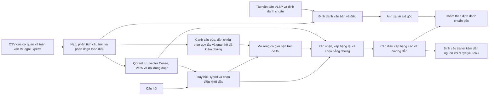

# Hướng dẫn viết luận văn và tái lập thực nghiệm GraphRAG cho pháp luật Việt Nam

## 1. Câu hỏi nghiên cứu và kết quả chính

Khi trả lời một câu hỏi pháp luật, tìm đúng văn bản mới là bước đầu. Hệ thống còn phải tìm đúng điều chứa căn cứ cho câu trả lời. Nghiên cứu này xem xét liệu các liên kết giữa những điều luật có giúp ích ở bước đó hay không. Mốc so sánh là Hybrid, phương pháp kết hợp BGE-M3 và BM25. Kết quả được chấm theo từng điều, dùng mã định danh gốc của bộ dữ liệu VLSP. Các thực nghiệm trong tài liệu diễn ra từ tháng 9 đến ngày 21/11/2026.

| Câu hỏi nghiên cứu | Kết quả chính |
| --- | --- |
| Khi một điều dẫn chiếu rõ sang văn bản khác, đồ thị có giúp tìm đúng điều được dẫn không? | Trên 107 bài toán kiểm tra, đồ thị tìm được cả điều nguồn lẫn điều đích trong **105/107** trường hợp. Hybrid nhận cùng cụm dẫn chiếu và bộ lọc số hiệu văn bản đích đạt **83/107**. Tra cứu chính xác theo khóa điều đạt **107/107**. [Báo cáo dẫn chiếu](https://github.com/Minhnhat45/simple_legal_graphrag/blob/main/reports/reference_follow_20261121.md) |
| Mở rộng qua đồ thị có cải thiện truy hồi trên câu hỏi tự nhiên? | Trên 400 câu có ánh xạ đầy đủ, Recall@10 đạt **92,46%** với đồ thị, **89,96%** với Hybrid mặc định và **91,27%** với Hybrid đã hiệu chỉnh. So với Hybrid đã hiệu chỉnh, mức tăng quan sát được là **+1,19 điểm phần trăm**. Khoảng tin cậy vẫn chứa 0. [Báo cáo câu hỏi tự nhiên](https://github.com/Minhnhat45/simple_legal_graphrag/blob/main/reports/natural_graph_20261121.md) |
| Lựa chọn mô hình trích xuất quan hệ ảnh hưởng thế nào đến kết quả? | Trên 165 cặp điều được kiểm soát, sau khi kiểm tra cả trích đoạn làm bằng chứng, macro-F1 của ba nhãn chính đạt **33,87%** với Gemma 4 và **100,00%** với GPT-6-Luna. Trong phép truy hồi sử dụng lại 29 cặp nguồn–đích, cả hai đồ thị làm giàu đều thu hồi đủ hai điều trong mười kết quả đầu ở **29/29** trường hợp. [Báo cáo đối chiếu mô hình](https://github.com/Minhnhat45/simple_legal_graphrag/blob/main/reports/relation_model_comparison_20261121.md) |

Các phần tiếp theo trình bày [kiến trúc hệ thống](#2-kiến-trúc-và-phương-pháp), [chỉ số đánh giá](#3-chỉ-số-đánh-giá), [thực nghiệm và kết quả](#4-thực-nghiệm-và-kết-quả), [quy trình tái lập](#5-quy-trình-tái-lập) và [cấu trúc luận văn](#6-trình-bày-luận-văn-và-bảo-vệ).

## 2. Kiến trúc và phương pháp

### 2.1. Chuẩn bị dữ liệu và định danh bằng chứng



1. **Tìm toàn văn theo số hiệu.** Điểm xuất phát là 2.157 `law_id` khác nhau trong `corpus.csv` của VLSP. Với mỗi mã, hệ thống tìm số hiệu trùng khớp trong trường `Số hiệu` của CSV, hoặc trong siêu dữ liệu hay tiêu đề ngữ cảnh của ViLegalExperts. Trước khi so khớp chính xác, hệ thống cắt khoảng trắng ở tiêu đề theo quy tắc đã định. Hai bản ghi cùng số hiệu vẫn có thể khác cơ quan ban hành hoặc phiên bản, nên cả hai đều được giữ lại. Kho cục bộ có toàn văn cho **1.869/2.157** số hiệu, còn thiếu **288** số hiệu. Tổng cộng có **2.051 bản ghi nguồn**, gồm **1.969 dòng CSV** và **82 tệp ngữ cảnh**. Trong CSV, trường `ID` phân biệt các bản ghi ngay cả khi chúng có cùng số hiệu. [Kiểm kê dữ liệu](https://github.com/Minhnhat45/simple_legal_graphrag/blob/main/data/README.md) · [Thống kê lọc nguồn](https://github.com/Minhnhat45/simple_legal_graphrag/blob/main/data/summary.json) · [Mã lọc nguồn](https://github.com/Minhnhat45/simple_legal_graphrag/blob/main/data/build.py)
2. **Chia văn bản theo cấu trúc pháp lý.** Bộ nạp đọc lần lượt các bản ghi trong CSV UTF-8 gồm 14 cột, kể cả khi trường `Toàn văn` trải dài nhiều dòng. Mỗi bản ghi giữ các thuộc tính như tiêu đề, số hiệu, cơ quan ban hành, ngành, lĩnh vực, người ký, trạng thái và ngày tháng. Sau khi nhận diện chương, điều, khoản và điểm, hệ thống ưu tiên chia ở ranh giới điều. Nếu nội dung còn dài, hệ thống chia tiếp thành các đoạn tối đa 1.800 ký tự, với 250 ký tự lặp lại giữa hai đoạn liền kề theo cấu hình mặc định. Đoạn đưa vào chỉ mục có thể kèm tiêu đề lấy từ siêu dữ liệu. Ở phiên bản đã hiệu chỉnh, hệ thống chia riêng từng điều và ghi rõ mỗi đoạn thuộc điều nào. [Bộ nạp CSV](https://github.com/Minhnhat45/simple_legal_graphrag/blob/main/src/legal_graphrag/csv_loader.py) · [Bộ phân tích cấu trúc](https://github.com/Minhnhat45/simple_legal_graphrag/blob/main/src/legal_graphrag/structure.py) · [Bộ phân đoạn](https://github.com/Minhnhat45/simple_legal_graphrag/blob/main/src/legal_graphrag/chunking.py)
3. **Phân biệt mã văn bản, mã điều và mã đoạn.** Số hiệu cho biết văn bản pháp luật nào đang được nói tới. Mã văn bản nguồn cho biết hệ thống đã nạp bản ghi nào. Trong đồ thị, mỗi điều có một mã nội bộ, chẳng hạn `112405:article:8`. Khi tiêu đề điều lặp lại, mã có thể có thêm hậu tố. Mỗi đoạn trong điều cũng có mã riêng. Khi chấm kết quả, hệ thống dùng `aid`, mã điều gốc mà VLSP ghi trong `relevant_aids` của `eval.csv` và `relevant_laws` của `train.csv`. Dù tìm được nhiều đoạn thuộc cùng một điều, hệ thống chỉ tính điều đó một lần. [Định dạng dữ liệu](https://github.com/Minhnhat45/simple_legal_graphrag/blob/main/data/README.md) · [Bộ nạp dữ liệu đánh giá](https://github.com/Minhnhat45/simple_legal_graphrag/blob/main/src/legal_graphrag/evaluation.py) · [Đặc tả DRiLL](https://vlsp.org.vn/vlsp2025/eval/drill)
4. **Ghép điều trong chỉ mục với `aid` của VLSP.** Trong lần thăm dò ngày 07/11, hệ thống dùng lại các vector tương ứng và kiểm tra xem đoạn văn này có chứa nguyên văn đoạn kia hay không. Quy trình sau hiệu chỉnh đặt điều kiện cụ thể hơn. Toàn bộ nội dung điều của VLSP sau chuẩn hóa phải dài ít nhất 30 ký tự và xuất hiện trong đúng một điều nguồn có cùng số hiệu. Hệ thống loại các ánh xạ nhiều–một. Bước chuẩn hóa xử lý Unicode NFC, khoảng trắng, kiểu dấu ngoặc kép và khoảng trắng bị thiếu trước chữ hoa đầu câu. Việc so khớp này giữ nguyên văn bản nguồn và nhãn chuẩn. Nếu hai điều chỉ giống nhau về nội dung, cần xác minh độc lập trước khi dùng cặp đó làm ánh xạ cho nghiên cứu. [Mã tạo bản chụp và ánh xạ](https://github.com/Minhnhat45/simple_legal_graphrag/blob/main/scripts/repair_coverage.py) · [Kiểm tra khoảng trống ánh xạ](https://github.com/Minhnhat45/simple_legal_graphrag/blob/main/scripts/audit_mapping_gaps.py)

### 2.2. Công nghệ truy hồi và xếp hạng

| Công nghệ | Vai trò trong hệ thống |
| --- | --- |
| **Dense embeddings và độ tương đồng cosine** | BGE-M3 mã hóa câu hỏi và đoạn văn thành các vector có cùng số chiều. Hệ thống dùng độ tương đồng cosine, tức tích vô hướng đã chuẩn hóa, để so sánh vector của câu hỏi với vector của từng đoạn. Những đoạn gần nhau về chủ đề có thể đạt cosine cao dù khác số hiệu hoặc số điều. Ollama phục vụ cùng mô hình cho lập chỉ mục và truy vấn. [Bài báo BGE-M3](https://arxiv.org/abs/2402.03216) · [Tích hợp Ollama](https://github.com/Minhnhat45/simple_legal_graphrag/blob/main/src/legal_graphrag/llm.py) |
| **BM25 và vector thưa** | BM25 xếp hạng dựa trên các từ xuất hiện trong văn bản. Điểm phụ thuộc vào độ hiếm của từ trong tập văn bản (IDF), độ dài văn bản và số lần từ xuất hiện. Mỗi lần lặp thêm đóng góp ít điểm hơn lần trước. FastEmbed mã hóa trường `bm25` bằng `Qdrant/bm25` với `avg_len=256.0` và `disable_stemmer=True`. Qdrant áp dụng hệ số IDF cho trường này và đo cosine trên trường `dense`. [Bài báo BM25](https://www.ccs.neu.edu/home/vip/teach/IRcourse/IR_surveys/robertson_foundations.pdf) · [Mã lập chỉ mục](https://github.com/Minhnhat45/simple_legal_graphrag/blob/main/ingest.py) · [Truy vấn Qdrant](https://github.com/Minhnhat45/simple_legal_graphrag/blob/main/src/legal_graphrag/qdrant_store.py) |
| **Reciprocal Rank Fusion (RRF)** | Qdrant hợp nhất thứ hạng Dense và BM25 bằng RRF. Công thức thường dùng là `sum(1 / (k + rank))` trên các danh sách chứa kết quả. Một đoạn đứng càng cao trong một danh sách thì danh sách đó đóng góp càng nhiều vào điểm chung. Bộ xếp hạng lại ban đầu còn sử dụng đặc trưng `1 / (60 + rank)` sau bước hợp nhất. [Bài báo RRF](https://cormack.uwaterloo.ca/cormack/cormacksigir09-rrf.pdf) · [Truy vấn Hybrid trong Qdrant](https://qdrant.tech/documentation/search/hybrid-queries/) · [Mã xếp hạng](https://github.com/Minhnhat45/simple_legal_graphrag/blob/main/src/legal_graphrag/retrieval.py) |
| **TF-IDF và n-gram** | Bộ sinh cặp văn bản dùng TF-IDF của scikit-learn với các cụm gồm 1–4 từ liên tiếp (n-gram) để tìm cụm từ chung. Ở cấp điều, n-gram thưa cùng những tín hiệu khác được dùng để tạo cặp ứng viên trước bước kiểm chứng. `ngram_frequencies.py` khảo sát tần suất cụm từ trong tập văn bản. Đường cơ sở truy hồi câu hỏi dùng BM25 và RRF. [Quan hệ cấp văn bản](https://github.com/Minhnhat45/simple_legal_graphrag/blob/main/src/legal_graphrag/relation_builder.py) · [Quan hệ cấp điều](https://github.com/Minhnhat45/simple_legal_graphrag/blob/main/src/legal_graphrag/semantic.py) · [Công cụ n-gram](https://github.com/Minhnhat45/simple_legal_graphrag/blob/main/ngram_frequencies.py) |
| **Neo4j và Cypher** | Dịch vụ và thử nghiệm cấp điều ban đầu dùng nút có nhãn và cạnh có kiểu, có hướng. Đồ thị cấp văn bản nối bản ghi với văn bản pháp luật, cơ quan, người và siêu dữ liệu. Đồ thị cấp điều lưu cấu trúc phân cấp và cạnh có bằng chứng. Các lệnh Cypher dùng định danh ổn định, ràng buộc và `MERGE` để khi chạy lại, hệ thống vẫn ghi vào cùng các nút và cạnh. [Kho đồ thị](https://github.com/Minhnhat45/simple_legal_graphrag/blob/main/src/legal_graphrag/graph_store.py) · [Neo4j `MERGE`](https://neo4j.com/docs/cypher-manual/current/clauses/merge/) |
| **SQLite, FTS5 và danh sách kề** | Các thực nghiệm sau dùng bản chụp SQLite cố định chứa văn bản, điều, đoạn và thuộc tính quan hệ. FTS5 hỗ trợ tìm toàn văn và kiểm tra độ phủ. `SnapshotGraph` và các chương trình ngày 21/11 nạp cạnh từ SQLite và duyệt bằng Python. Truy hồi Hybrid trong thực nghiệm dùng Qdrant. Dịch vụ và thử nghiệm ban đầu cần Neo4j đang hoạt động. [Mã tạo bản chụp](https://github.com/Minhnhat45/simple_legal_graphrag/blob/main/scripts/repair_coverage.py) · [Mã duyệt đồ thị](https://github.com/Minhnhat45/simple_legal_graphrag/blob/main/src/legal_graphrag/experiment.py) · [SQLite FTS5](https://www.sqlite.org/fts5.html) |
| **Ollama, OpenRouter và đầu ra có cấu trúc** | Ollama chạy `bge-m3`, `gemma4:e4b` và mô hình chấm Qwen cục bộ. OpenRouter phục vụ cấu hình GPT-6-Luna đã lưu. Sau khi yêu cầu mô hình trả về JSON, mã Python kiểm tra lược đồ, định danh, trích đoạn và trạng thái kết thúc. Phản hồi được lưu đệm theo nội dung và cấu hình yêu cầu. [Ollama Structured Outputs](https://docs.ollama.com/capabilities/structured-outputs) · [OpenRouter Structured Outputs](https://openrouter.ai/docs/guides/features/structured-outputs) · [Tích hợp OpenRouter](https://github.com/Minhnhat45/simple_legal_graphrag/blob/main/src/legal_graphrag/openrouter.py) |
| **Python, FastAPI, Uvicorn và Docker Compose** | Python thực hiện nạp dữ liệu, điều phối thực nghiệm, chấm điểm và vận hành CLI. FastAPI xác thực đầu vào JSON và cung cấp `GET /health`, `GET /v1/stats` và `POST /v1/query`. API chạy trên Uvicorn. Docker Compose định nghĩa Neo4j, Qdrant và container API tùy chọn. API mặc định dùng bộ truy hồi cấp văn bản ban đầu. [API](https://github.com/Minhnhat45/simple_legal_graphrag/blob/main/src/legal_graphrag/api.py) · [CLI](https://github.com/Minhnhat45/simple_legal_graphrag/blob/main/src/legal_graphrag/cli.py) · [Docker Compose](https://github.com/Minhnhat45/simple_legal_graphrag/blob/main/docker-compose.yml) · [Thư viện phụ thuộc](https://github.com/Minhnhat45/simple_legal_graphrag/blob/main/requirements.txt) |

### 2.3. Xây dựng đồ thị và sử dụng khi truy vấn

- **Xây dựng đồ thị ngoại tuyến.** `CONTAINS` nối các cấp cấu trúc, `HAS_CHUNK` liên kết điều với đoạn bằng chứng và `MENTIONS` biểu diễn tín hiệu dẫn chiếu từ các quy tắc kinh nghiệm ở cấp văn bản. Hệ thống chỉ tạo cạnh dẫn chiếu theo quy tắc khi xác định được duy nhất một đích. Ở cấp điều, `PROVISION_RELATION` lưu cặp đầu mút có hướng và trường `kind`, với các loại như `CITES`, `AMENDS`, `ADDS_TO`, `REPEALS`, `REPLACES`, `DETAILS`, `SPECIFIES`, `SETS_CONDITION_FOR`, `EXCEPTION_TO` và `PENALTY_FOR`. `DEFINES` và `REGULATES` có thể nối điều với `LegalConcept`. `LegalFact` lưu sự kiện có căn cứ, chẳng hạn nghĩa vụ. Cạnh có bằng chứng lưu mã đoạn ở hai đầu, trích đoạn, độ tin cậy, nguồn gốc và giới hạn thời gian khi có dữ liệu. [Hệ kiểu quan hệ](https://github.com/Minhnhat45/simple_legal_graphrag/blob/main/src/legal_graphrag/ontology.py) · [Mô hình dữ liệu](https://github.com/Minhnhat45/simple_legal_graphrag/blob/main/src/legal_graphrag/models.py) · [Mã ghi đồ thị](https://github.com/Minhnhat45/simple_legal_graphrag/blob/main/src/legal_graphrag/graph_store.py)
- **Kiểm chứng quan hệ đề xuất.** Bộ xây dựng tạo cặp có hướng từ dẫn chiếu tường minh, độ tương đồng từ vựng và ngữ nghĩa, cùng các khái niệm có căn cứ. Mô hình ngôn ngữ lớn (LLM) nhận định danh rút gọn và các đoạn bằng chứng. Quy trình kiểm tra định dạng, đầu mút, trích đoạn liên tục tại nguồn và đích, hướng quan hệ và phạm vi điều khoản. Quan hệ sửa đổi chính thức còn cần lời văn thể hiện tác động pháp lý. Bộ kiểm chứng đánh giá riêng chủ thể, hành vi và phạm vi. Hai điều nằm gần nhau hoặc nói về cùng chủ đề có thể được đưa vào danh sách để kiểm tra. Khoảng thời gian suy từ siêu dữ liệu cần được đối chiếu với căn cứ về thời điểm và phạm vi hiệu lực. [Trích xuất quan hệ](https://github.com/Minhnhat45/simple_legal_graphrag/blob/main/src/legal_graphrag/semantic.py) · [Xây dựng đồ thị qua OpenRouter](https://github.com/Minhnhat45/simple_legal_graphrag/blob/main/scripts/build_openrouter_graph.py)
- **Từ câu hỏi đến bằng chứng.** Hybrid tìm các đoạn ban đầu. Hệ thống gộp những đoạn thuộc cùng một điều, rồi lấy các điều khác nhau làm điểm xuất phát để duyệt đồ thị. Phạm vi duyệt phụ thuộc vào họ cạnh, độ tin cậy, độ sâu, số nhánh, hệ số suy giảm và giới hạn ứng viên. Dù duyệt ngược, hệ thống vẫn ghi hướng gốc của cạnh để có thể lần lại đường đi. Trong luồng M0–M4, Qdrant áp dụng cùng bộ lọc khi xác nhận đoạn ứng viên và bằng chứng ở hai đầu cạnh. Sau khi xếp hạng lại, hệ thống chọn các đoạn đại diện vừa với giới hạn ngữ cảnh. Riêng ở thực nghiệm dẫn chiếu ngày 21/11, cả phương pháp đồ thị và tra cứu chính xác đều ưu tiên điều đích đã xác định, rồi dùng Hybrid để điền các vị trí còn lại. [Mã truy hồi](https://github.com/Minhnhat45/simple_legal_graphrag/blob/main/src/legal_graphrag/retrieval.py) · [Mã thực nghiệm dẫn chiếu](https://github.com/Minhnhat45/simple_legal_graphrag/blob/main/scripts/run_reference_experiment.py)
- **Mỗi đối chứng trả lời một câu hỏi khác nhau.** Tăng số ứng viên của Hybrid giúp kiểm tra liệu chỉ cần tìm rộng hơn đã đủ để cải thiện kết quả. Dùng cùng hàm điểm cho Hybrid và đồ thị giúp so sánh hai tập ứng viên trên cùng cách xếp hạng. Thêm điểm đường dẫn cho biết bằng chứng dọc đường duyệt ảnh hưởng thế nào đến thứ hạng. Một đối chứng chỉ thêm các điều trong cùng văn bản. Đối chứng khác hoán vị đầu mút của cạnh nhưng giữ điều kiện mở rộng tương đương để kiểm tra vai trò của việc nối đúng điều. Khi đã biết số hiệu và số điều, tra cứu chính xác theo khóa cho biết có thể xác định điều đích đến mức nào. Phép chẩn đoán tháng 11 dùng `0.7 × max(0, cosine) + 0.15 × query-token overlap` và một biến thể cộng thêm điểm đường dẫn. Với câu hỏi tự nhiên, hàm điểm được hiệu chỉnh riêng trên tập phát triển. [Mã chẩn đoán có đối chứng](https://github.com/Minhnhat45/simple_legal_graphrag/blob/main/scripts/run_repaired_experiment.py) · [Mã thực nghiệm câu hỏi tự nhiên](https://github.com/Minhnhat45/simple_legal_graphrag/blob/main/scripts/run_natural_graph_experiment.py)
- **Sinh câu trả lời có dẫn nguồn.** Khi người dùng yêu cầu câu trả lời, dịch vụ gửi các đoạn đã chọn cho mô hình. Mô hình trả lời bằng tiếng Việt, dẫn nguồn theo dạng `[S1]` và nêu rõ khi bằng chứng chưa đủ. Dịch vụ kiểm tra chỉ mục nguồn rồi trả về siêu dữ liệu cùng ngữ cảnh đồ thị. Muốn biết đoạn trích có thực sự hỗ trợ câu trả lời hay không, vẫn cần đọc nội dung đoạn đó. Trong hệ thống này, đồ thị giúp mở rộng và chọn bằng chứng ở cấp điều trước khi sinh câu trả lời. Phần nghiên cứu liên quan trình bày thêm hướng tổng hợp thông tin theo cộng đồng đồ thị. [Dịch vụ sinh câu trả lời](https://github.com/Minhnhat45/simple_legal_graphrag/blob/main/src/legal_graphrag/service.py) · [Lewis và cộng sự về RAG](https://arxiv.org/abs/2005.11401) · [Edge và cộng sự về tổng hợp theo đồ thị](https://arxiv.org/abs/2404.16130)

## 3. Chỉ số đánh giá

Mỗi câu hỏi có một tập đáp án chuẩn `G`, gồm các `aid` gốc của VLSP, kể cả những `aid` chưa ghép được với điều nào trong chỉ mục. Gọi `C` là tập điều ứng viên đã xác nhận và đã quy về mã dùng để chấm. Từ tập này, hệ thống trả về tối đa mười điều khác nhau đứng đầu bảng xếp hạng, ký hiệu là `R10`. Khi tính Recall@10 chung, mỗi câu hỏi có trọng số như nhau.

| Chỉ số | Định nghĩa và ý nghĩa |
| --- | --- |
| **Hit@10** | Tỷ lệ câu hỏi có ít nhất một điều chuẩn trong `R10`. |
| **Precision@10** | `count(R10 ∩ G) / 10`. Mẫu số giữ nguyên bằng 10 khi hệ thống trả về ít hơn mười điều. |
| **Recall@10** | `count(R10 ∩ G) / count(G)`, lấy trung bình trên các câu hỏi. |
| **Tỷ lệ đủ bằng chứng trong mười kết quả đầu** | Tỷ lệ câu có toàn bộ điều chuẩn trong `R10`. Với bài toán dẫn chiếu, chỉ số yêu cầu có cả điều nguồn và điều đích. |
| **Candidate Recall** | `count(C ∩ G) / count(G)` trước khi xếp hạng. Chênh lệch với Recall@10 cho biết phần nhãn chuẩn có mặt trong tập ứng viên nhưng chưa xuất hiện trong kết quả. |
| **Trần Recall do ánh xạ** | Trung bình của `count(mapped G) / count(G)`. Giới hạn này đạt được khi truy hồi đủ mọi điều chuẩn đã ánh xạ. |
| **MRR và nDCG@10** | MRR lấy trung bình nghịch đảo thứ hạng của điều đúng đầu tiên. nDCG@10 với độ liên quan nhị phân chiết khấu từng điều đúng theo `log2(rank + 1)` và chuẩn hóa theo thứ tự lý tưởng. |
| **F1@10 và macro-F1 của quan hệ** | F1@10 là trung bình theo câu của trung bình điều hòa giữa Precision@10 và Recall@10. Macro-F1 của quan hệ lấy trung bình F1 trên các lớp đã chỉ định. Mỗi lớp dùng số dương tính đúng, dương tính giả và âm tính giả riêng. |
| **Target@3 và đóng góp của đường dẫn** | Target@3 đo tỷ lệ điều đích xuất hiện trong ba vị trí đầu. Vết truy hồi ghi cơ chế tìm thấy điều đích qua cạnh, khóa chính xác hay truy hồi bổ sung. |
| **Tỷ lệ đúng tự động và tỷ lệ trích dẫn được hỗ trợ đầy đủ** | Trong thực nghiệm Luna, tỷ lệ đúng dùng các lượt chấm có đủ văn bản tham chiếu. Tỷ lệ hỗ trợ trích dẫn dùng toàn bộ lượt chấm hợp lệ. Bước sinh và bước chấm ẩn cấu hình sử dụng cùng một mô hình. |

Giả sử một câu hỏi cần hai điều luật. Trong mười kết quả đầu, hệ thống tìm được một điều đúng ở vị trí thứ tư. Khi đó Hit@10 bằng 1, Recall@10 bằng 0,5 và Precision@10 bằng 0,1. Nghịch đảo thứ hạng là 0,25. Điểm đủ bằng chứng bằng 0 vì vẫn thiếu điều thứ hai. Nếu ban đầu cả hai điều đều có trong tập ứng viên, Candidate Recall bằng 1. Khi ấy, cần tìm nguyên nhân ở bước xếp hạng hoặc chọn ngữ cảnh. Nếu điều thứ hai chưa được ánh xạ vào chỉ mục, trần Recall của câu hỏi chỉ là 0,5. [Mã chấm](https://github.com/Minhnhat45/simple_legal_graphrag/blob/main/src/legal_graphrag/evaluation.py) · [Mã đánh giá có đối chứng](https://github.com/Minhnhat45/simple_legal_graphrag/blob/main/scripts/run_repaired_experiment.py)

Tài liệu dùng **điểm phần trăm (pp)** để biểu thị chênh lệch giữa hai tỷ lệ. Ví dụ, từ 89,96% lên 92,46% là tăng +2,50 pp. Để ước lượng khoảng tin cậy, phép bootstrap ghép cặp so sánh hai cấu hình trên cùng câu hỏi rồi lấy mẫu lại có hoàn lại. Các phép chẩn đoán dùng 2.000 lần lấy mẫu lại, còn hai thực nghiệm truy hồi chính ngày 21/11 dùng 10.000 lần. Khi đối chiếu mô hình, đơn vị lấy mẫu là cụm các cặp điều có liên hệ qua số hiệu văn bản, với 5.000 lần lấy mẫu lại. Nếu khoảng tin cậy trải từ giá trị âm sang giá trị dương và chứa 0, dữ liệu vẫn phù hợp với cả khả năng tăng, giảm hoặc không có chênh lệch. Với nhóm con và chỉ số phụ, cần đọc kết quả theo phạm vi đã xác định trong giao thức. [Mã bootstrap](https://github.com/Minhnhat45/simple_legal_graphrag/blob/main/src/legal_graphrag/experiment.py) · [Phân tích ghép cặp cho dẫn chiếu](https://github.com/Minhnhat45/simple_legal_graphrag/blob/main/scripts/run_reference_experiment.py) · [Thống kê so sánh mô hình](https://github.com/Minhnhat45/simple_legal_graphrag/blob/main/scripts/run_relation_model_comparison.py)

## 4. Thực nghiệm và kết quả

### 4.1. Tháng 9–10/2026 · Nguyên mẫu, quan hệ cấp văn bản và đường cơ sở Hybrid

Nguyên mẫu đầu tiên lưu đồ thị cấp văn bản trong FalkorDB và tìm đoạn bằng truy hồi Dense trong Qdrant. Từ các đoạn tìm được, hệ thống lần theo số hiệu, dẫn chiếu hoặc siêu dữ liệu để tìm văn bản liên quan. Sau khi xác nhận đoạn ở các văn bản này, Gemma dùng chúng để trả lời và dẫn nguồn. Dự án chuyển sang Neo4j ở commit `e4026fe` và bổ sung BGE-M3 ở commit `f5fd59e`. Lịch sử commit cho biết hai thay đổi diễn ra khi nào. Muốn biết mỗi thay đổi ảnh hưởng ra sao đến chất lượng truy hồi, vẫn cần phép so sánh A/B. [Lịch sử phát triển và thực nghiệm](https://github.com/Minhnhat45/simple_legal_graphrag/blob/main/docs/RESEARCH_EXPERIMENT_JOURNEY.md#3-dòng-thời-gian-thực-nghiệm)

Ngày 29/09, bộ xây dựng quan hệ cấp văn bản (`97bfdd7`) kết hợp tín hiệu Dense, TF-IDF, thực thể và dẫn chiếu tường minh. Các dẫn chiếu tường minh được xét ngoài giới hạn ứng viên thông thường của mỗi nguồn. Trong lần kiểm thử với ba văn bản, hệ thống lập chỉ mục chín đoạn, xét sáu cặp có hướng và gọi Gemma sáu lần. Đồ thị giữ hai cạnh, gồm một dẫn chiếu theo quy tắc và một quan hệ bãi bỏ có bằng chứng từ `sample-003` đến `sample-001`. Một số hiệu thiếu nguồn vẫn chưa phân giải được. Lần xây dựng đầu mất 119,446 giây, lần lặp mất 44,813 giây và giữ nguyên hai cạnh. Bộ xếp hạng lại trả về cùng bằng chứng cho câu hỏi kiểm thử. Hồ sơ chưa có kết quả cho hai phép kiểm tra khác là lần lượt bỏ từng tín hiệu tạo ứng viên và đo Precision bằng nhãn độc lập. [Kế hoạch ban đầu](https://github.com/Minhnhat45/simple_legal_graphrag/blob/main/plan.md) · [Kiểm thử đã lưu](https://github.com/Minhnhat45/simple_legal_graphrag/blob/main/README.md#historical-sample-validation-preserved)

Trong tháng 10, commit `382b286` bổ sung `ingest.py` và `qdrant.py`, cho phép chạy riêng BM25, Dense và Hybrid. Cần lưu ý đơn vị chấm khi đọc lại kết quả giai đoạn này. Điểm Hit@10 **0,95** được tính theo đoạn trên một tập văn bản khác. Các bảng trong luận văn chấm theo điều và so sánh với Hybrid chạy trong cùng điều kiện. Hồ sơ hiện chưa có bảng kết quả của cả BM25, Dense và Hybrid trên cùng các bộ đánh giá cấp điều về sau. [Mã lập chỉ mục](https://github.com/Minhnhat45/simple_legal_graphrag/blob/main/ingest.py) · [CLI đường cơ sở](https://github.com/Minhnhat45/simple_legal_graphrag/blob/main/qdrant.py) · [Nguồn của điểm lịch sử](https://github.com/Minhnhat45/simple_legal_graphrag/blob/main/reports/semantic_graphrag_20261107.md)

### 4.2. Ngày 07/11 · Thử nghiệm thăm dò đồ thị cấp điều

Để xem cạnh cấu trúc, dẫn chiếu và quan hệ ngữ nghĩa có đưa điều đúng lên cao hơn hay không, thực nghiệm cho mọi cấu hình xuất phát từ cùng một danh sách kết quả Hybrid của mỗi câu hỏi.

**Chuẩn bị chỉ mục và đồ thị.** Chỉ mục của lần chạy này gồm **6.707 đoạn** thuộc **709 văn bản nguồn**, với **1.863 điều** ánh xạ được sang định danh gốc. Hệ thống kiểm tra mã băm mô hình và nội dung đã chuẩn hóa trước khi dùng lại vector. Có **168 đoạn** được mã hóa lại vì văn bản dùng để tạo vector ban đầu vượt ranh giới điều. Đồ thị Neo4j có **128.685 nút cấu phần pháp lý**, gồm **25.394 nút `Article`**, trong đó 1.863 điều có bằng chứng đã ánh xạ và truy hồi được. Một lần kiểm tra với bộ phân tích cải tiến tạo 6.788 mục dự kiến lập chỉ mục. [Danh mục đầu vào](https://github.com/Minhnhat45/simple_legal_graphrag/blob/main/reports/runs/20261107/manifest.json) · [Kiểm tra vector](https://github.com/Minhnhat45/simple_legal_graphrag/blob/main/reports/runs/20261107/embedding_repair.json) · [Báo cáo thăm dò](https://github.com/Minhnhat45/simple_legal_graphrag/blob/main/reports/semantic_graphrag_20261107.md)

**Trích xuất quan hệ.** Từ 100 điều nguồn, hệ thống tạo 3.886 cặp ứng viên có hướng. Lần xây dựng cuối phân loại 40 cặp, gồm 26 kết quả trong bộ đệm và 14 lượt gọi mới. Hệ thống loại năm phản hồi sai định dạng và ba đề xuất dẫn sai phạm vi khoản. Trong 15 lượt kiểm chứng, mô hình chấp nhận một cạnh. Đồ thị cuối có **245 cạnh `CITES`**, trong đó sáu cạnh liên văn bản, cùng **một cạnh `SPECIFIES`**, **54 sự kiện** và 35 quan hệ khái niệm. Lần gọi xây dựng cuối mất **394,7 giây**. Lần chạy chẩn đoán cho thấy định danh dài và đầu ra có cấu trúc dễ phát sinh lỗi. Quy trình sau đó dùng định danh rút gọn, xác thực lược đồ và kiểm chứng phạm vi riêng. [Quan hệ đã lưu](https://github.com/Minhnhat45/simple_legal_graphrag/blob/main/reports/runs/20261107/final/relations.json) · [Đầu ra chẩn đoán](https://github.com/Minhnhat45/simple_legal_graphrag/blob/main/reports/runs/20261107/pilot/diagnostic.json)

| Cấu hình | Nguồn bằng chứng bổ sung | Recall@10, 100 câu | Recall@10, 68 câu đủ ánh xạ | nDCG@10 | Độ trễ truy hồi p50 / p95 (ms) |
| --- | --- | ---: | ---: | ---: | ---: |
| M0 | Hybrid | 63,83% | 92,65% | 0,5688 | 13,3 / 14,8 |
| M1 | Cạnh cấu trúc giữa các điều cùng cấp | 63,83% | 92,65% | 0,5685 | 20,9 / 27,3 |
| M2 | Quan hệ tường minh | 63,83% | 92,65% | 0,5691 | 17,6 / 21,1 |
| M3 | Quan hệ ngữ nghĩa | 63,83% | 92,65% | 0,5688 | 14,3 / 16,3 |
| M4 | Kết hợp các họ cạnh | 63,83% | 92,65% | 0,5689 | 23,5 / 31,4 |

Năm cấu hình dùng cùng 100 câu và `aid` chuẩn, tối đa 60 ứng viên, năm điều khởi đầu, độ sâu hai, 12 nhánh mỗi nút, ngưỡng tin cậy 0,8, hệ số suy giảm 0,65 và trọng số đồ thị 0,15. Mọi cấu hình đạt Candidate Recall **65,33%**, Hit@10 **66,00%**, Precision@10 **7,00%** và F1@10 **12,53%**. MRR là 0,5628 với M0, M2 và M3, và 0,5626 với M1 và M4. Số lượt tìm thêm được điều chuẩn từ ngoài tập ứng viên Hybrid là 0. Với câu `15959`, cạnh trong M2 đưa `aid=54193` từ hạng 7 lên hạng 5 nên điểm đánh giá thứ hạng thay đổi dù vẫn tìm được cùng điều đó. Lần chạy tuần tự trước đó truy vấn Hybrid riêng cho từng cấu hình và cho Recall@10 của M4 là 63,33%. Bảng trên dùng đầu ra `frozen_seeds/evaluation.json`. Thời gian truy hồi được đo sau khi khởi tạo kênh thưa và tách riêng bước mã hóa câu hỏi. [Kết quả dùng chung danh sách khởi đầu](https://github.com/Minhnhat45/simple_legal_graphrag/blob/main/reports/runs/20261107/frozen_seeds/evaluation.json) · [Tổng hợp lần chạy tuần tự](https://github.com/Minhnhat45/simple_legal_graphrag/blob/main/reports/runs/20261107/final/summary.json)

### 4.3. Ngày 11/11 · Phân tích lỗi theo công đoạn

Để tìm nguyên nhân bỏ sót bằng chứng, bước phân tích ngày 11/11 đối chiếu **500 dự đoán** của lần thăm dò với nhãn VLSP và danh mục nguồn. Ở mỗi cấu hình, hệ thống bỏ sót tất cả các điều chuẩn ở 34/100 câu. Nếu chỉ xét đúng văn bản đích, vẫn có 25/100 câu không tìm được văn bản nào trong đáp án. VLSP chia hai nhóm `single_chunk` và `multiple_chunks` theo số đoạn chuẩn. Số câu bỏ sót toàn bộ điều chuẩn lần lượt là 25/50 và 9/50. Khi chỉ xét câu đã ánh xạ đủ, các con số còn 2/27 và 2/41. Như vậy, một phần đáng kể chênh lệch ban đầu giữa hai nhóm đến từ độ phủ ánh xạ. [Phân tích lỗi](https://github.com/Minhnhat45/simple_legal_graphrag/blob/main/reports/failure_analysis_20261107.md) · [Dữ liệu từng câu](https://github.com/Minhnhat45/simple_legal_graphrag/blob/main/reports/failure_analysis_20261107.csv)

| Công đoạn | Kết quả chẩn đoán | Ví dụ |
| --- | --- | --- |
| Độ phủ và định danh | **36/43** lượt điều chuẩn bị hụt chưa có ánh xạ vào chỉ mục. Ở cấp văn bản, 11 cặp câu–văn bản bị hụt do thiếu nguồn cục bộ và chín cặp có nguồn nhưng thiếu điều trong chỉ mục. | Với câu `7105`, nguồn của `02/2022/TT-BTNMT` chỉ có siêu dữ liệu. |
| Tạo tập ứng viên | **5/43** lượt điều bị hụt đã có chỉ mục nhưng vắng trong tập ứng viên. | Câu `6920` thiếu `aid=5469` dù kết quả có đề cập chủ đề cư trú và chứng thực. |
| Xếp hạng hoặc chọn ngữ cảnh | **2/43** lượt điều bị hụt có mặt trong tập ứng viên nhưng nằm ngoài mười vị trí đầu. | Với câu `1164`, `aid=8863` có mặt trong tập ứng viên và nằm ngoài top 10. |

Khi một câu hỏi bị thiếu điều đúng, có thể lần ngược theo từng bước. Trước hết, kiểm tra kho cục bộ có toàn văn hay chưa, bộ phân tích đã tách đúng ranh giới điều chưa và điều đó đã có ánh xạ hay chưa. Sau đó mới kiểm tra tập ứng viên, bằng chứng trên đường duyệt và thứ hạng cuối. Nếu câu hỏi nhắm đến một khoản hoặc điểm cụ thể, cần đọc cả đoạn được trả về. Phép chấm ở cấp văn bản chỉ quy các điều về số hiệu, nên vẫn có thể ghi nhận tìm đúng văn bản dù hệ thống bỏ sót điều cần tìm. [Kế hoạch chẩn đoán](https://github.com/Minhnhat45/simple_legal_graphrag/blob/main/plan_fixing_failure_11_11.md) · [Mã phân tích lỗi](https://github.com/Minhnhat45/simple_legal_graphrag/blob/main/scripts/analyze_failures.py)

### 4.4. Ngày 13–18/11 · Hiệu chỉnh độ phủ và đánh giá lại truy hồi

**Hiệu chỉnh dữ liệu.** Khi toàn văn đã bị dàn thành một dòng, tiêu đề điều có thể nằm ngay sau tên chương hoặc mục viết hoa. Bộ phân tích được sửa để nhận ra các tiêu đề này. Số điều phân tích được tăng từ **47.155 lên 55.898**. Việc chuẩn hóa Unicode NFC, dấu ngoặc kép và khoảng trắng trước chữ hoa đầu câu đưa số `aid` chấp nhận từ **24.927 lên 36.107** qua các lần kiểm tra. Riêng thay đổi khoảng trắng bổ sung 4.919 ánh xạ và loại 119 ánh xạ trở nên mơ hồ. Bản chụp cuối gồm **2.051 văn bản nguồn**, **55.898 điều**, **91.405 đoạn** và **19.674 dẫn chiếu phân giải bằng quy tắc**. Có 46 văn bản chưa nhận diện được tiêu đề điều. [Báo cáo hiệu chỉnh bộ phân tích](https://github.com/Minhnhat45/simple_legal_graphrag/blob/main/reports/fixing_failure_20261113.md) · [Báo cáo độ phủ sau hiệu chỉnh](https://github.com/Minhnhat45/simple_legal_graphrag/blob/main/reports/fixing_failure_linux_20261118.md#corpus-and-identity-coverage) · [Kiểm tra định danh](https://github.com/Minhnhat45/simple_legal_graphrag/blob/main/reports/runs/linux_20261118/identity_audit.json)

**Bao nhiêu câu có thể chấm đủ các điều chuẩn?** Sau hiệu chỉnh, **59/100** câu có ánh xạ cho tất cả các điều trong đáp án. Tính trên toàn bộ tập, hệ thống ánh xạ được **66/113** lượt điều chuẩn. Trần Recall tính trung bình theo câu là **60,50%**. Có 53 câu đủ ánh xạ theo cả quy tắc thăm dò cũ lẫn quy tắc mới. Có 15 câu chỉ đạt theo quy tắc cũ và sáu câu chỉ đạt theo quy tắc mới. Vì thành phần hai tập có khác nhau, các cấu hình được so sánh trên cùng tập định danh cố định trong từng lần chạy. [Báo cáo đối chiếu định danh](https://github.com/Minhnhat45/simple_legal_graphrag/blob/main/reports/fixing_failure_linux_20261118.md#corpus-and-identity-coverage)

**Truy hồi có đối chứng.** Bảy cấu hình dùng chung chỉ mục Qdrant chứa 91.405 đoạn và cùng đầu ra Hybrid của từng câu. Hệ thống trả tối đa 10 điều với 18.000 ký tự bằng chứng và giới hạn 60 ứng viên, riêng `hybrid_larger` dùng 120. Trên 100 câu, Recall@10 đạt **52,00%** với cả hai cấu hình Hybrid mặc định và mở rộng tập ứng viên, **50,50%** với Hybrid và đồ thị dẫn chiếu dùng cùng hàm điểm, và **52,50%** với đồ thị dùng hàm điểm ban đầu. Đồ thị dẫn chiếu dùng hàm điểm chung cao hơn đồ thị hoán vị **+1,00 pp**, khoảng tin cậy 95% **[0,00; 3,00] pp**. Với câu `9882`, đường dẫn hai bước bổ sung `aid=56079` từ ngoài tập ứng viên Hybrid, nhưng điều này lần lượt ở hạng 53, 44 và 49 với hàm điểm chung, hàm có điểm đường dẫn và hàm điểm ban đầu. Đường dẫn đã tìm đúng điều còn thiếu, nhưng cả ba cách xếp hạng đều đặt điều đó ngoài mười vị trí đầu. Vì thế Recall@10 của câu này chưa tăng. [Bảng kết quả truy hồi](https://github.com/Minhnhat45/simple_legal_graphrag/blob/main/reports/fixing_failure_linux_20261118.md#controlled-retrieval-results) · [Đầu ra đánh giá](https://github.com/Minhnhat45/simple_legal_graphrag/blob/main/reports/runs/linux_20261118/comparison_v2/evaluation.json) · [Dự đoán từng câu](https://github.com/Minhnhat45/simple_legal_graphrag/blob/main/reports/runs/linux_20261118/comparison_v2/predictions.jsonl)

**Chấm tự động và chuẩn bị tập câu hỏi quan hệ.** Gemma sinh câu trả lời cho 20 câu được lấy theo thứ tự SHA-256 ở cả bảy cấu hình. `qwen3.5:9b` chấm dựa trên toàn văn điều chuẩn và đoạn truy hồi, với cấu hình được ẩn. Cả **140 lượt chấm** đều trả về kết quả sai lược đồ. Phép rà soát 50 cạnh dừng sau phản hồi chấm đầu tiên không hợp lệ. Các chỉ số chất lượng của hai phép chấm được ghi là `unavailable`. Từ 237 câu huấn luyện đủ điều kiện, nhóm chọn 30 câu phát triển và 30 câu dự trữ để đánh giá quan hệ. Hai tập tách biệt về họ văn bản và đều được tách khỏi tập chẩn đoán. [Giao thức chấm câu trả lời](https://github.com/Minhnhat45/simple_legal_graphrag/blob/main/reports/runs/linux_20261118/review/answer_protocol.json) · [Kết quả chấm thử](https://github.com/Minhnhat45/simple_legal_graphrag/blob/main/reports/fixing_failure_linux_20261118.md#sampled-answer-evaluation) · [Rà soát quan hệ và tập câu hỏi](https://github.com/Minhnhat45/simple_legal_graphrag/blob/main/reports/fixing_failure_linux_20261118.md#relationship-review-and-relational-benchmark)

### 4.5. Ngày 19/11 · Làm giàu đồ thị và chấm tự động bằng GPT-6-Luna

**Xây dựng đồ thị.** Bản chụp sau hiệu chỉnh và vector hiện có là đầu vào của bộ sưu tập `legal_openrouter_20261119_v1`. BGE-M3 mã hóa câu hỏi. GPT-6-Luna qua OpenRouter đề xuất và xác minh cạnh, sàng lọc câu hỏi, sinh câu trả lời và chấm tự động. Định danh mô hình lưu trong hồ sơ là `openai/gpt-6-luna-20260922`, với mức suy luận `medium`. Quy trình chọn 1.000 điều nguồn theo mã băm ổn định và phân loại 1.000 cặp ứng viên. Trong các lượt đề xuất của LLM, hệ thống chấp nhận 285 lượt và loại 539 đề xuất. Sau khử trùng lặp, đồ thị cuối có **19.678 `CITES`**, **69 `SPECIFIES`**, **7 `SETS_CONDITION_FOR`**, **2 `REPEALS`** và **1 `PENALTY_FOR`**. Đồ thị theo quy tắc đầu vào đóng góp 19.674 cạnh dẫn chiếu. [Đầu ra xây dựng đồ thị](https://github.com/Minhnhat45/simple_legal_graphrag/blob/main/reports/runs/openrouter_20261119/graph_build.json) · [Báo cáo OpenRouter](https://github.com/Minhnhat45/simple_legal_graphrag/blob/main/reports/openrouter_experiment_20261119.md)

**Truy hồi trên 100 câu chẩn đoán.** Các cấu hình dùng chung nhãn chuẩn và danh sách kết quả Hybrid cho từng câu, giới hạn 10 điều trả về, 18.000 ký tự bằng chứng và tối đa 60 ứng viên, riêng `hybrid_larger` dùng 120. `citation_shared` chỉ dùng dẫn chiếu theo quy tắc. `graph_shared` dùng đồ thị làm giàu với cùng hàm điểm. [Giao thức và kết quả chẩn đoán](https://github.com/Minhnhat45/simple_legal_graphrag/blob/main/reports/openrouter_experiment_20261119.md#diagnostic-retrieval-100-questions)

| Cấu hình | Candidate Recall | Recall@10 | Đủ bằng chứng trong mười kết quả đầu |
| --- | ---: | ---: | ---: |
| Hybrid mặc định và Hybrid với tập ứng viên lớn hơn | 57,50% | 52,00% | 49,00% |
| Hybrid dùng hàm điểm chung | 57,50% | 50,50% | 48,00% |
| Đồ thị dẫn chiếu dùng hàm điểm chung | 57,00% | 50,50% | 48,00% |
| Đồ thị làm giàu dùng hàm điểm chung | 57,00% | 50,50% | 48,00% |
| Đồ thị làm giàu dùng hàm điểm chung có điểm đường dẫn | 57,00% | 50,50% | 48,00% |
| Đồ thị làm giàu dùng hàm điểm ban đầu | 57,00% | 52,50% | 50,00% |
| Đồ thị hoán vị dùng hàm điểm chung | 56,00% | 50,50% | 48,00% |

Nếu chỉ xét 59 câu đã ánh xạ đủ, Hybrid mặc định đạt Recall@10 **86,44%**. Đồ thị làm giàu đạt **83,90%** với hàm điểm chung và **87,29%** với hàm điểm ban đầu. Trên toàn bộ 100 câu, cả bốn cấu hình dùng chung hàm điểm đều đạt Recall@10 **50,50%**, gồm Hybrid, đồ thị dẫn chiếu, đồ thị làm giàu và đồ thị hoán vị. Vết truy hồi cũng cho thấy **0/100 câu** có ứng viên mở rộng được xác nhận nhờ một cạnh ngoài loại dẫn chiếu. Do đó, lần chạy này chưa cho biết nhiều về giá trị truy hồi của những cạnh ngữ nghĩa mới thêm. [Kết quả từng cấu hình](https://github.com/Minhnhat45/simple_legal_graphrag/blob/main/reports/runs/openrouter_20261119/comparison/evaluation.json)

- **Chấm câu trả lời.** Cả **800 lượt chấm** hợp lệ về lược đồ, tương ứng **353 ngữ cảnh sinh và lượt chấm phân biệt** sau khi dùng bộ đệm. Hybrid mặc định đạt **68,09%** về tỷ lệ đúng tự động và **73,00%** về hỗ trợ đầy đủ cho trích dẫn. Ba cấu hình Hybrid, đồ thị dẫn chiếu và đồ thị làm giàu dùng chung hàm điểm đều đạt **69,15%** và **76,00%**, với 94 lượt đủ văn bản tham chiếu dùng để tính tỷ lệ đúng. Cấu hình có điểm đường dẫn đạt **70,21%** và **78,00%**, với một chỉ mục dẫn nguồn không hợp lệ. Vì Luna chấm chính câu trả lời mình sinh ra, sai sót ở hai bước có thể liên quan với nhau và kết quả có thể chịu thiên lệch tự đánh giá. [Đầu ra chấm câu trả lời](https://github.com/Minhnhat45/simple_legal_graphrag/blob/main/reports/runs/openrouter_20261119/answers/evaluation.json)
- **Rà soát cạnh.** Mô hình xác nhận **25/25** dẫn chiếu nội văn bản và **24/25** dẫn chiếu liên văn bản trong mẫu cạnh theo quy tắc. Trong mẫu cạnh mới, số cạnh được xác nhận là **10/10 `CITES`**, **1/1 `PENALTY_FOR`**, **2/2 `REPEALS`**, **5/7 `SETS_CONDITION_FOR`** và **8/10 `SPECIFIES`**. Mỗi tỷ lệ chỉ cho biết mô hình xác nhận bao nhiêu cạnh trong nhóm đã lấy mẫu. Ước lượng Precision pháp lý trên toàn đồ thị cần trọng số lấy mẫu và đánh giá độc lập. [Đầu ra rà soát cạnh](https://github.com/Minhnhat45/simple_legal_graphrag/blob/main/reports/runs/openrouter_20261119/precision/evaluation.json)
- **Tập phát triển về quan hệ.** Luna đánh dấu **5/30** câu có đủ văn bản tham chiếu và cần liên kết giữa các điều. Trên 30 câu, Recall@10 là **33,33%** với Hybrid mặc định, **35,00%** với đồ thị dùng hàm điểm chung và **40,56%** khi cộng điểm đường dẫn. Trên năm câu đã sàng lọc, cấu hình có điểm đường dẫn đạt **50,00%**, so với **40,00%** của Hybrid mặc định. Tập 30 câu dự trữ được giữ nguyên đến phép đánh giá truy hồi thăm dò ngày 21/11. Vẫn cần người đánh giá độc lập xác định câu nào trong tập dự trữ thực sự đòi hỏi liên kết giữa các điều. [Kết quả tập phát triển và tập dự trữ](https://github.com/Minhnhat45/simple_legal_graphrag/blob/main/reports/openrouter_experiment_20261119.md#relational-development-set-and-reserved-test-set)

### 4.6. Ngày 21/11 · Truy hồi theo dẫn chiếu liên văn bản tường minh

Để tạo bài toán, chương trình tìm trong toàn văn những chỗ một điều dẫn rõ sang điều khác. Cả điều nguồn lẫn điều đích đều phải có một định danh duy nhất trong chỉ mục. Việc chọn mẫu diễn ra trước khi đọc cạnh đồ thị hoặc kết quả truy hồi. Từ **745** đoạn dẫn chiếu đủ điều kiện, quy trình chọn **132** đoạn theo thứ tự mã băm cố định, với mỗi số hiệu chỉ xuất hiện trong một cặp. Tập phát triển có **25** bài toán và tập kiểm tra có **107** bài toán. Mỗi câu nêu số hiệu và số điều nguồn, cung cấp cụm từ ngay trước dẫn chiếu và yêu cầu truy hồi cả hai điều. Nhãn chuẩn cấp điều được xác định từ văn bản nguồn. Các cấu hình truy hồi tiếp theo dùng chung phép tra cứu điều nguồn và cụm từ dẫn chiếu. Giới hạn gồm 60 ứng viên, 12 vị trí truy hồi tiếp theo, 10 điều phân biệt được trả về và 18.000 ký tự bằng chứng. [Bộ bài toán](https://github.com/Minhnhat45/simple_legal_graphrag/blob/main/reports/runs/reference_follow_20261121/benchmark.json) · [Giao thức](https://github.com/Minhnhat45/simple_legal_graphrag/blob/main/reports/runs/reference_follow_20261121/protocol.json)

| Cấu hình trên tập kiểm tra | Đủ hai điều trong mười kết quả đầu | Recall@10 cấp điều | Target@3 |
| --- | ---: | ---: | ---: |
| Hybrid mặc định | 42/107 | 68,69% | 14,02% |
| Hybrid với truy vấn viết lại từ dẫn chiếu | 40/107 | 68,69% | 14,02% |
| Hybrid với dẫn chiếu và bộ lọc số hiệu đích | 83/107 | 88,79% | 20,56% |
| Đồ thị, bổ sung kết quả bằng Hybrid | **105/107** | **99,07%** | **88,79%** |
| Đồ thị hoán vị, bổ sung kết quả bằng Hybrid | 79/107 | 86,92% | 5,61% |
| Tra cứu chính xác theo khóa điều | **107/107** | **100,00%** | **100,00%** |

So với Hybrid có bộ lọc, đồ thị tìm đủ cả hai điều trong thêm 22 trường hợp. Ở cả 22 trường hợp này, vết truy hồi cho thấy hệ thống đã đi theo một cạnh đến đúng điều đích. Tỷ lệ đủ bằng chứng tăng **20,56 pp**, với khoảng tin cậy ghép cặp 95% **[13,08; 28,04] pp** và kiểm định ghép cặp chính xác hai phía cho **p = 4,77 × 10⁻⁷**. So với đồ thị hoán vị, mức tăng là **24,30 pp**, khoảng tin cậy **[16,82; 32,71] pp**. Trong hai trường hợp đồ thị bỏ sót, vết truy hồi đều thiếu cạnh phù hợp. Tra cứu theo khóa tìm được đích trong cả hai trường hợp. [Kết quả tập kiểm tra](https://github.com/Minhnhat45/simple_legal_graphrag/blob/main/reports/runs/reference_follow_20261121/held_out/summary.json)

**Ví dụ phân tích vết truy hồi.** Bài toán `08d732f5cfe2578681e4` bắt đầu từ Điều 8 của `19/2016/TT-BXD`, dẫn đến điểm a khoản 1 Điều 18 của `99/2015/NĐ-CP`. Hybrid có bộ lọc văn bản đích tìm thấy điều nguồn và một số điều của văn bản đích, nhưng mười kết quả đầu vẫn thiếu đúng Điều 18 cần tìm. Đồ thị đưa điều nguồn lên hạng 1 và điều đích `92902:article:18` lên hạng 3. Tra cứu theo khóa đưa điều đích lên hạng 2. Trong bài toán `6a459ea31a0118a945df`, vết duyệt đồ thị thiếu đích khớp, còn tra cứu theo khóa xác định được `133859:article:3`. Cả hai ví dụ đều được chấm ở cấp điều. [Ví dụ thành công](https://github.com/Minhnhat45/simple_legal_graphrag/blob/main/reports/runs/reference_follow_20261121/held_out/08d732f5cfe2578681e4.json) · [Ví dụ bị hụt](https://github.com/Minhnhat45/simple_legal_graphrag/blob/main/reports/runs/reference_follow_20261121/held_out/6a459ea31a0118a945df.json)

### 4.7. Ngày 21/11 · Câu hỏi tự nhiên và hiệu chỉnh mở rộng qua đồ thị

Tập phát triển gồm 100 câu chẩn đoán và 30 câu phát triển về quan hệ. Tập kiểm tra gồm **400 câu hỏi tự nhiên** lấy từ dữ liệu huấn luyện VLSP, với toàn bộ điều chuẩn đã ánh xạ. Quy trình chọn mẫu tất định, loại câu trùng, loại số hiệu chuẩn trùng với tập phát triển hoặc tập dự trữ trước đó, và chỉ dùng mỗi số hiệu chuẩn trong một câu kiểm tra. Do ưu tiên chọn câu cần nhiều điều, tập kiểm tra cuối cùng gồm **57 câu nhiều bằng chứng** và **343 câu một bằng chứng**. Tập kiểm tra được giữ riêng trong bước hiệu chỉnh xếp hạng. Chưa rõ các mô hình đã từng gặp những câu hỏi VLSP này hay chưa. [Tập câu hỏi cố định](https://github.com/Minhnhat45/simple_legal_graphrag/blob/main/reports/runs/natural_graph_20261121/benchmark.json) · [Báo cáo câu hỏi tự nhiên](https://github.com/Minhnhat45/simple_legal_graphrag/blob/main/reports/natural_graph_20261121.md)

Năm cấu hình dùng chung kết quả BGE-M3/BM25 theo từng câu. Đồ thị mở rộng từ 20 điều Hybrid phân biệt đầu tiên và có thể đưa thêm tối đa 24 điều vào tập tối đa 60 ứng viên. Hệ thống tìm thêm ứng viên qua các điều lân cận, cạnh dẫn chiếu hoặc cạnh có kiểu với độ tin cậy từ 0,8, và 1.145 dẫn chiếu liên văn bản được phân giải từ văn bản nguồn ở một lượt bổ sung. Hàm điểm giữ cố định các vị trí Hybrid đầu rồi xếp phần còn lại theo `cosine + rank_weight / sqrt(hybrid_rank) + lexical_weight × overlap + path_weight × support`. Bộ tham số theo thứ tự số vị trí cố định, trọng số thứ hạng, trọng số từ vựng và trọng số đường dẫn là `[3, 0.45, 0, 0]` cho Hybrid đã hiệu chỉnh và Hybrid mở rộng trong phạm vi văn bản, và `[3, 0.12, 0, 0.12]` cho đồ thị và đồ thị hoán vị. Bước hiệu chỉnh dùng Recall trung bình và tỷ lệ đủ bằng chứng trên tập phát triển. [Tham số xếp hạng](https://github.com/Minhnhat45/simple_legal_graphrag/blob/main/reports/runs/natural_graph_20261121/ranking.json) · [Hàm điểm và lưới tham số](https://github.com/Minhnhat45/simple_legal_graphrag/blob/main/scripts/run_natural_graph_experiment.py)

| Cấu hình | Candidate Recall | Recall@10 | Đủ bằng chứng trong mười kết quả đầu |
| --- | ---: | ---: | ---: |
| Hybrid mặc định | 96,44% | 89,96% | 341/400 (85,25%) |
| Hybrid có bộ xếp hạng lại đã hiệu chỉnh | 96,44% | 91,27% | 348/400 (87,00%) |
| Hybrid mở rộng trong phạm vi văn bản | 96,81% | 91,27% | 348/400 (87,00%) |
| Đồ thị hoán vị | 95,81% | 91,27% | 348/400 (87,00%) |
| Đồ thị | **97,25%** | **92,46%** | **358/400 (89,50%)** |

Đồ thị cải thiện Recall@10 ở 19 câu so với Hybrid mặc định. Điểm của 381 câu còn lại giữ nguyên. Trong 19 lượt tìm thêm được điều đúng, chỉ **hai** lượt cần đến điều nằm ngoài tập ứng viên Hybrid ban đầu. Ở **17** lượt còn lại, điều đúng đã có sẵn và được đưa vào mười vị trí đầu khi xếp hạng lại. Mức tăng Recall@10 là **+2,50 pp**, với khoảng tin cậy ghép cặp 95% **[1,44; 3,75] pp**. Khi so với Hybrid đã hiệu chỉnh, mức tăng ở chỉ số chính Recall@10 còn **+1,19 pp [−0,19; 2,56]**. Đối với chỉ số thăm dò về tỷ lệ tìm đủ bằng chứng, mức tăng là **+2,50 pp [0,75; 4,50]**. [Kết quả tập kiểm tra và khoảng tin cậy](https://github.com/Minhnhat45/simple_legal_graphrag/blob/main/reports/runs/natural_graph_20261121/held_out/summary.json)

Khác biệt tập trung ở 57 câu cần nhiều bằng chứng. Trên nhóm này, Recall@10 của đồ thị là **78,65%**, so với **68,57%** của Hybrid đã hiệu chỉnh. Chênh lệch trong phân tích thăm dò là **+10,09 pp [5,26; 15,35]**. Với 343 câu chỉ cần một bằng chứng, hai cấu hình lần lượt đạt **94,75%** và **95,04%**. Khi xem lại nhãn chuẩn, có tới 53/57 câu nhiều bằng chứng có các điều cùng số hiệu văn bản. Với bốn câu cần điều thuộc nhiều số hiệu, mọi cấu hình đều đạt Recall@10 **75,00%**. Một câu có thể cần nhiều điều làm căn cứ độc lập cho câu trả lời. Để biết từng họ cạnh đóng góp bao nhiêu trên câu hỏi tự nhiên, vẫn cần thực nghiệm lần lượt loại từng họ cạnh. [Thống kê nhóm con](https://github.com/Minhnhat45/simple_legal_graphrag/blob/main/reports/runs/natural_graph_20261121/held_out/summary.json) · [Phân nhóm hồi cứu theo số hiệu](https://github.com/Minhnhat45/simple_legal_graphrag/blob/main/docs/RESEARCH_EXPERIMENT_JOURNEY.md#48-đồ-thị-và-reranking-trên-câu-vlsp-tự-nhiên-2111)

Tập dự trữ có 30 câu, nhưng chỉ **12/30** câu đã ánh xạ đủ. Trên cả 30 câu, Recall@10 lần lượt là **53,33%** với đồ thị, **47,22%** với Hybrid mặc định và **45,56%** với Hybrid đã hiệu chỉnh. Trên 130 câu phát triển, theo cùng thứ tự, các kết quả là **51,18%**, **47,69%** và **49,49%**. Khi viết báo cáo, dùng 400 câu kiểm tra cho bảng kết quả chính. Kết quả trên 30 câu dự trữ thuộc phần phân tích thăm dò. [Tập dự trữ](https://github.com/Minhnhat45/simple_legal_graphrag/blob/main/reports/runs/natural_graph_20261121/legacy_reserved/summary.json) · [Tập phát triển](https://github.com/Minhnhat45/simple_legal_graphrag/blob/main/reports/runs/natural_graph_20261121/known_development/summary.json)

### 4.8. Ngày 21/11 · Đối chiếu Gemma 4 và GPT-6-Luna trên cùng cặp điều

**Thiết kế.** Từ mỗi đoạn tường minh thể hiện tác động pháp lý hoặc dẫn chiếu, bộ tạo dữ liệu lập một cặp có hướng đúng, một cặp đảo hướng và một cặp vẫn trỏ đến đúng văn bản đích nhưng chọn sai điều. Tập phát triển có **24 cặp thuộc 8 nhóm**. Tập kiểm tra có **165 cặp thuộc 55 nhóm**, gồm **55 cặp dương tính** và **110 cặp đối chứng**. Hai tập không dùng chung số hiệu văn bản. Hai mô hình nhận cùng đoạn văn với định danh cặp đã che và trả về một nhãn có hướng kèm trích đoạn nguồn liên tục hoặc nhãn `NONE`. Gemma cục bộ dùng bản lượng tử hóa Q4_K_M, định dạng Gemma trực tiếp qua Ollama `/api/generate` và trường suy luận để trống. Giao thức này được chọn sau lượt thử `/api/chat` cho JSON thiếu ổn định. Luna dùng mức suy luận `medium`. Các kết quả áp dụng cho hai cấu hình đã ghi nhận, với ảnh hưởng riêng của kích thước mô hình, dữ liệu huấn luyện, phương thức truyền lời nhắc và lượng tử hóa chưa được tách ra. [Tập đánh giá cuối](https://github.com/Minhnhat45/simple_legal_graphrag/blob/main/reports/runs/relation_model_comparison_20261121_v2/benchmark.json) · [Giao thức cuối](https://github.com/Minhnhat45/simple_legal_graphrag/blob/main/reports/runs/relation_model_comparison_20261121_v2/protocol.json)

| Nhãn quan hệ | Số cặp dương tính trong tập kiểm tra | Gemma F1 | Luna F1 |
| --- | ---: | ---: | ---: |
| `ADDS_TO` | 4 | 20,00% | 100,00% |
| `AMENDS` | 6 | 18,18% | 100,00% |
| `REPEALS` | 16 | 63,41% | 100,00% |
| `DETAILS` | 1 | 50,00% | 66,67% |
| `REPLACES` | 2 | 0,00% | 100,00% |
| `CITES` | 26 | 65,52% | 96,15% |
| **Macro-F1 chính (ba nhãn đầu)** | 26 | **33,87%** | **100,00%** |

Chênh lệch macro-F1 chính của Luna so với Gemma là **+66,13 pp [54,42; 80,18]**. Trên năm nhãn ngoài `CITES`, macro-F1 lần lượt là **30,32%** với Gemma và **93,33%** với Luna. Khi chỉ chấm nhãn, macro-F1 chính lần lượt là **45,92%** và **100,00%**. Gemma có **77/165** dự đoán lỗi lược đồ, định danh hoặc trích đoạn, và tạo cạnh được chấp nhận cho **34/110** cặp âm tính. Luna có 0 lỗi xác thực và tạo cạnh được chấp nhận cho **1/110** cặp âm tính. Với nhiều nhãn, tập kiểm tra chỉ có vài ví dụ dương tính thể hiện rõ quan hệ. Nhãn chuẩn được xác lập từ văn bản nguồn và chưa qua chú giải pháp lý độc lập. [Dự đoán từng cặp](https://github.com/Minhnhat45/simple_legal_graphrag/blob/main/reports/runs/relation_model_comparison_20261121_v2/scored_test.json) · [Tổng hợp tập kiểm tra](https://github.com/Minhnhat45/simple_legal_graphrag/blob/main/reports/runs/relation_model_comparison_20261121_v2/summary_test.json)

**Kiểm chứng chéo.** Sau khi bỏ các đề xuất trùng nhau, cả hai mô hình cùng kiểm tra **127 đề xuất**. Ở bước này, mô hình kiểm chứng không biết đề xuất đến từ mô hình nào. Theo tiêu chuẩn nghiêm ngặt về trích đoạn chuẩn, Luna giữ **79/84** đề xuất có căn cứ và loại **38/43** đề xuất còn lại. Gemma giữ **68/84** và loại **17/43**. Với đề xuất của Gemma, macro-F1 đạt **37,96%** khi Gemma kiểm chứng và **50,24%** khi Luna kiểm chứng. Với đề xuất của Luna, các giá trị tương ứng là **93,52%** và **98,92%**. Trong thiết kế này, thay mô hình đề xuất tạo ra chênh lệch lớn hơn thay mô hình kiểm chứng. Cấu hình Luna/Luna cũng có trường hợp loại cạnh hợp lệ. [Tập đề xuất](https://github.com/Minhnhat45/simple_legal_graphrag/blob/main/reports/runs/relation_model_comparison_20261121_v2/proposals_test.json) · [Kết quả đối chiếu mô hình](https://github.com/Minhnhat45/simple_legal_graphrag/blob/main/reports/relation_model_comparison_20261121.json)

**Khi đã biết điều nguồn và có trích đoạn làm mốc.** Thực nghiệm dùng lại 29 cặp dương tính ngoài `CITES` đã chấm ở trên. Mỗi bài toán cho sẵn điều nguồn, đoạn trích làm mốc và kiểu quan hệ. Hai cấu hình bắt đầu từ cùng một đồ thị xây bằng quy tắc. Mỗi cấu hình thêm các cạnh đã được chấp nhận của mô hình tương ứng rồi dùng Hybrid để điền các vị trí còn lại. Vì vậy, khi đọc bảng dưới đây cần xét cả những cạnh đã có sẵn, cách Hybrid bổ sung kết quả và vị trí của điều đích trong bảng xếp hạng. [Giao thức truy hồi](https://github.com/Minhnhat45/simple_legal_graphrag/blob/main/reports/runs/relation_model_comparison_20261121_v2/retrieval/protocol.json) · [Kết quả từng bài toán](https://github.com/Minhnhat45/simple_legal_graphrag/blob/main/reports/runs/relation_model_comparison_20261121_v2/retrieval/rows.json)

| Cấu hình truy hồi | Đủ hai điều trong mười kết quả đầu | Điều đích ở top 3 |
| --- | ---: | ---: |
| Hybrid với cùng đoạn làm mốc | 18/29 | 8/29 |
| Đồ thị theo quy tắc và Hybrid | 27/29 | 25/29 |
| Đồ thị theo quy tắc, cạnh Gemma/Gemma và Hybrid | **29/29** | 27/29 |
| Đồ thị theo quy tắc, cạnh Luna/Luna và Hybrid | **29/29** | **29/29** |
| Tra cứu chính xác theo khóa điều | **29/29** | **29/29** |

### 4.9. Thời gian và chi phí ghi nhận trong kỳ thực nghiệm

| Mốc | Số đo | Phạm vi đo |
| --- | --- | --- |
| 07/11 | Trung vị mã hóa câu hỏi 77,1 ms. Trung vị truy hồi M0 là 13,3 ms và M4 là 23,5 ms. | Thời gian truy hồi được đo sau mã hóa. [Báo cáo thăm dò](https://github.com/Minhnhat45/simple_legal_graphrag/blob/main/reports/semantic_graphrag_20261107.md) |
| 13–18/11 | Lập chỉ mục toàn bộ 91.405 đoạn mất 1.183,43 giây. Trung vị truy hồi Hybrid mặc định là 24,13 ms. | Lập chỉ mục dùng lô 64 đoạn trên RTX 5060 Ti với 16 GiB VRAM. Thời gian truy hồi bao gồm truy vấn Hybrid dùng chung. [Số đo sau hiệu chỉnh](https://github.com/Minhnhat45/simple_legal_graphrag/blob/main/reports/fixing_failure_linux_20261118.md#cost-reproducibility-and-limits) |
| 19/11 | Sao chép vector mất 68,16 giây. Lần gọi xây dựng đồ thị cuối mất 2.293,89 giây. Trung bình truy hồi là 16,73 ms với Hybrid và 19,62 ms với đồ thị làm giàu dùng hàm điểm chung. Chi phí **1,471671 USD** từ 2.553 phản hồi API đã lưu. | Thời gian xây dựng tính từ lần gọi tiếp tục cuối. Số đo truy hồi tách riêng mã hóa và sinh câu trả lời. Chi phí theo phản hồi có thông tin sử dụng. [Chi phí thực nghiệm OpenRouter](https://github.com/Minhnhat45/simple_legal_graphrag/blob/main/reports/openrouter_experiment_20261119.md#cost-validation-and-reproduction) |
| 21/11 | Thực nghiệm đối chiếu cuối có 86 yêu cầu Luna với chi phí **0,033575700 USD**. Lượt thử kỹ thuật tốn **0,018947375 USD**. Trung vị thời gian mỗi lô phân loại tập kiểm tra là 5,03 giây với Gemma và 4,05 giây với Luna. | Các số đo theo lô được quan sát với cấu hình phần cứng và mức đồng thời khác nhau. [Chi phí đối chiếu mô hình](https://github.com/Minhnhat45/simple_legal_graphrag/blob/main/reports/relation_model_comparison_20261121.md#thời-gian-chi-phí-và-khả-năng-tái-lập) |

Trong thực nghiệm dẫn chiếu, `all_modes_ms` cộng thời gian chạy nhiều cấu hình cho cùng một câu hỏi. Vì vậy, đây là số đo theo câu. Chi phí trong bảng lấy từ dữ liệu đã lưu tại thời điểm chạy. [Giao thức thực nghiệm dẫn chiếu](https://github.com/Minhnhat45/simple_legal_graphrag/blob/main/reports/runs/reference_follow_20261121/protocol.json)

## 5. Quy trình tái lập

### 5.1. Cài đặt và xác định đầu vào cố định

Chạy các khối lệnh dưới đây từ thư mục gốc của dự án, trong cùng một phiên Bash để dùng lại các biến đã khai báo. Biến `$py` trỏ tới Python trong môi trường ảo. Dự án yêu cầu Python từ 3.11 trở lên. Riêng lần chạy đối chứng ngày 18/11 dùng Python 3.13.11. Nếu muốn tái lập các số đo, hãy đối chiếu phiên bản thư viện và mã băm mô hình với hồ sơ của lần chạy đó. Với một bản sao mới của kho mã, cần bổ sung dữ liệu cục bộ, các chương trình thực nghiệm nằm ngoài commit lịch sử và các thư mục đầu ra mà Git bỏ qua. Để chạy lại bước truy hồi, còn cần khôi phục đúng trạng thái cơ sở dữ liệu. [Danh sách thư viện](https://github.com/Minhnhat45/simple_legal_graphrag/blob/main/requirements.txt) · [Môi trường lần chạy ngày 18/11](https://github.com/Minhnhat45/simple_legal_graphrag/blob/main/reports/runs/linux_20261118/environment.txt) · [Hồ sơ mã đã thực thi](https://github.com/Minhnhat45/simple_legal_graphrag/blob/main/reports/runs/linux_20261118/execution_provenance.json)

```bash
test -x .venv/bin/python || python3 -m venv .venv
py=.venv/bin/python
"$py" -m pip install -r requirements.txt
export PYTHONPATH=src
out="reports/runs/replay_$(date -u +%Y%m%dT%H%M%SZ)"
mkdir -p "$out"
suffix=$(basename "$out")
pilot=reports/runs/20261107
repair=reports/runs/linux_20261118
comparison=reports/runs/relation_model_comparison_20261121_v2

sha256sum data/vlsp/{corpus,eval,train}.csv \
  reports/runs/20261107/{manifest.json,frozen_seeds/evaluation.json} \
  reports/runs/linux_20261118/coverage_v2/snapshot.sqlite \
  reports/runs/openrouter_20261119/snapshot/snapshot.sqlite
"$py" -m unittest discover -s tests
```

Đối chiếu mã SHA-256 của CSV với kiểm kê dữ liệu. Mã của bản chụp SQLite `coverage_v2` là `3aee6d3d36c9f3e075b7e5a1ef3a1d0c394bf3720aac5ca1daa19aff1ec57113`. Mã của bản chụp OpenRouter là `b707b16f29c972615c98af5008dd95e9d21128f78aaa7ba8857787cc3d46f240`. Hồ sơ ghi mã băm của BGE-M3 là `7907646426070047a77226ac3e684fbbe8410524f7b4a74d02837e43f2146bab`. Hồ sơ kiểm tra lưu mã băm nguồn, bản vá và bản sao chương trình đã chạy. Khi báo cáo kết quả mới, lưu mã băm của cả mã thực thi và dữ liệu đánh giá. [Kiểm kê đầu vào](https://github.com/Minhnhat45/simple_legal_graphrag/blob/main/data/README.md#vlsp-inputs) · [Mã băm lần chạy ngày 18/11](https://github.com/Minhnhat45/simple_legal_graphrag/blob/main/reports/runs/linux_20261118/verified_inputs.sha256) · [Mã băm OpenRouter](https://github.com/Minhnhat45/simple_legal_graphrag/blob/main/reports/runs/openrouter_20261119/artifact_checksums.sha256)

Với các bước chạy cục bộ, tạo `.env` từ `.env.example` khi cần, chạy dịch vụ Ollama và khởi động kho dữ liệu phù hợp. Qdrant dùng cổng 6333, Ollama dùng 11434, Neo4j Bolt dùng 7687 và API tùy chọn dùng 8000. Gemma đảm nhiệm hai việc trong quy trình cục bộ là xây dựng đồ thị và sinh câu trả lời. Dùng `qwen3.5:9b` khi lặp phép chấm cục bộ. Quy trình OpenRouter ngày 19/11 và đối chiếu Luna ngày 21/11 dùng `OPEN_ROUTER_API` từ biến môi trường hoặc tệp `.env` bị Git bỏ qua. Lượt gọi mô hình qua OpenRouter phát sinh chi phí API. [Mẫu cấu hình](https://github.com/Minhnhat45/simple_legal_graphrag/blob/main/.env.example) · [Định nghĩa dịch vụ](https://github.com/Minhnhat45/simple_legal_graphrag/blob/main/docker-compose.yml)

```bash
test -f .env || cp .env.example .env
docker compose up -d neo4j qdrant
ollama pull bge-m3
ollama pull gemma4:e4b
curl -fsS http://localhost:6333/collections
curl -fsS http://localhost:11434/api/tags
```

Khi dựng lại hệ thống, hãy chọn thư mục đầu ra và bộ sưu tập mới. Nếu muốn giữ đồ thị lịch sử, hãy nạp dữ liệu minh họa vào một phiên bản Neo4j riêng. Cờ `--recreate` sẽ xóa dữ liệu đồ thị và bộ sưu tập vector mà cấu hình đang trỏ đến. Dịch vụ truy vấn dùng Neo4j, còn các chương trình thực nghiệm từ giai đoạn hiệu chỉnh độ phủ đọc đồ thị từ bản chụp SQLite. Nếu chỉ cần chấm lại dự đoán đã lưu, có thể chạy ngoại tuyến mà không cần khởi động mô hình hay cơ sở dữ liệu. [Ghi chú vận hành](https://github.com/Minhnhat45/simple_legal_graphrag/blob/main/README.md#consistency-and-operational-notes)

### 5.2. Đối chiếu số liệu từ đầu ra đã lưu

```bash
"$py" scripts/summarize_experiment.py \
  --evaluation "$pilot/frozen_seeds/evaluation.json" \
  --manifest "$pilot/manifest.json" --relations "$pilot/final/relations.json" \
  --output "$out/pilot_summary.json"
"$py" scripts/analyze_failures.py --output-prefix "$out/pilot_failures"
"$py" scripts/summarize_repaired_experiment.py \
  --snapshot "$repair/coverage_v2" --comparison "$repair/comparison_v2" \
  --output "$out/repair_summary.json"

"$py" - <<'PY'
import json
from pathlib import Path
from statistics import mean

from legal_graphrag.evaluation import score_ranking

runs = Path('reports/runs')
for file in (
    '20261107/frozen_seeds/evaluation.json',
    'linux_20261118/comparison_v2/evaluation.json',
    'openrouter_20261119/comparison/evaluation.json',
):
    saved = json.loads((runs / file).read_text())
    print(file)
    for config in saved['overall']:
        rows = [row for row in saved['predictions'] if row['mode'] == config]
        recalls = [score_ranking(row['retrieved'], row['gold'], 10)['recall'] for row in rows]
        print(f'  {config}: {mean(recalls):.2%} Recall@10 trên {len(rows)} câu')
PY
```

Cách kiểm tra phụ thuộc vào kết quả cần tái lập.

- **Dẫn chiếu liên văn bản.** Đếm số câu có giá trị `complete` đúng trong vết truy hồi. Vết này cũng ghi thứ hạng của cả điều nguồn và điều đích.
- **Câu hỏi tự nhiên.** Dùng `ranking.json` để chạy lại `select()` trên tập ứng viên của từng câu. Sau đó, dùng `snapshot/coverage.json` để đổi mã điều nội bộ về `aid` gốc và tính Recall trung bình theo câu.
- **Đối chiếu mô hình.** Từ `scored_test.json`, lập ma trận nhầm lẫn rồi tính trung bình F1 của ba lớp chính.

Đầu ra đã lưu cho phép kiểm tra lại đúng số liệu của lần chạy lịch sử. Nếu truy vấn Hybrid lại từ đầu, thứ tự các điều khởi đầu có thể thay đổi. [Vết truy hồi dẫn chiếu](https://github.com/Minhnhat45/simple_legal_graphrag/blob/main/reports/runs/reference_follow_20261121/held_out/) · [Vết truy hồi câu hỏi tự nhiên](https://github.com/Minhnhat45/simple_legal_graphrag/blob/main/reports/runs/natural_graph_20261121/held_out/) · [Đầu ra trích xuất](https://github.com/Minhnhat45/simple_legal_graphrag/blob/main/reports/runs/relation_model_comparison_20261121_v2/scored_test.json) · [Đầu ra truy hồi theo loại quan hệ](https://github.com/Minhnhat45/simple_legal_graphrag/blob/main/reports/runs/relation_model_comparison_20261121_v2/retrieval/rows.json)

Hồ sơ thực nghiệm ghi nhận việc đối chiếu thứ hạng trên 500 bản ghi thăm dò, 700 bản ghi chẩn đoán sau hiệu chỉnh và 800 bản ghi chẩn đoán Luna. Với câu hỏi tự nhiên, hàm điểm đã được chạy lại trên 560 bản ghi thuộc ba tập phát triển, kiểm tra và dự trữ. Đợt rà soát còn bao gồm 132 bài toán dẫn chiếu, 165 cặp kiểm tra mô hình và 29 bài toán truy hồi theo kiểu quan hệ.

Khi chạy lại bước chuẩn bị ngoại tuyến, hai tệp đánh giá ngày 21/11 cho dẫn chiếu và câu hỏi tự nhiên khớp bản gốc đến từng byte. Riêng bộ cặp điều có cùng các bản ghi và cùng nhóm bị loại, nhưng giá trị `builder_sha256` đã thay đổi. Vì vậy, hãy dùng tệp đánh giá cố định để tái lập lần đối chiếu mô hình gốc. Trong 70 ca kiểm thử, 68 ca đạt. Hai ca dùng dịch vụ trực tiếp cần được bật riêng.

### 5.3. Tạo lại tập nguồn, kiểm tra đường cơ sở và chạy lại thử nghiệm thăm dò

Muốn chạy lại bước lọc từ đầu, cần có dữ liệu gốc của các cơ quan và của ViLegalExperts. Các thực nghiệm sử dụng tập đã lọc trong thư mục dự án. Lưu bản lọc mới ở vị trí riêng để đối chiếu độ phủ hoặc mã băm. Có thể kiểm tra đường cơ sở bằng cách lập chỉ mục mười bản ghi trong một bộ sưu tập mới rồi truy vấn bằng cả ba chế độ. Dữ liệu kiểm thử tháng 9 được trích từ commit `97bfdd7`. Thử nghiệm cấp điều dùng danh mục đầu vào và bộ sưu tập riêng. [Đầu vào cho bước lọc](https://github.com/Minhnhat45/simple_legal_graphrag/blob/main/data/README.md#rebuild-the-source-filter) · [Thiết lập đường cơ sở](https://github.com/Minhnhat45/simple_legal_graphrag/blob/main/README.md#qdrant-only-bm25--embedding-baseline)

```bash
# Điền đường dẫn đến dữ liệu thô để chạy lại bước lọc nguồn.
"$py" data/build.py --corpus data/vlsp/corpus.csv \
  --departments /path/to/raw/departments --experts /path/to/raw/ViLegalExperts \
  --output "$out/filtered_sources"

baseline="thesis_demo_bm25_$suffix"
"$py" ingest.py data/departments/khoa_hoc_va_cong_nghe.csv --limit 10 --collection "$baseline"
for mode in bm25 dense hybrid; do
  "$py" qdrant.py --collection "$baseline" --mode "$mode" --limit 5 \
    --query 'quản lý nhiệm vụ khoa học và công nghệ'
done

git show 97bfdd7:data/sample_legal_documents.csv > "$out/sample_legal_documents.csv"
```

Để kiểm tra chức năng quan hệ cấp văn bản, dùng `.venv/bin/legal-graphrag ingest "$out/sample_legal_documents.csv" --collection "thesis_graph_$suffix" --hybrid`. Sau đó dùng `build-relations` với cùng tập dữ liệu và bộ sưu tập, rồi dùng `ask` với bộ sưu tập đó. Để kiểm tra đồ thị cấp điều trên dữ liệu minh họa đã nạp, dùng `build-semantic` và `retrieve-articles --mode M4`. Bộ sưu tập đường cơ sở độc lập chỉ chứa vector và payload. Trong khối lệnh dưới, lệnh đầu chạy lại thử nghiệm với đồ thị gốc đã lưu. Hai lệnh sau tạo và chạy một thử nghiệm độc lập. `prepare_experiment.py` tái sử dụng vector trong `vlsp_legal_bge_m3` sau khi kiểm tra mô hình và nội dung. Muốn xem chương trình dự kiến xử lý những dữ liệu nào, hãy chạy lệnh không có `--apply`. [CLI dịch vụ](https://github.com/Minhnhat45/simple_legal_graphrag/blob/main/src/legal_graphrag/cli.py) · [Chuẩn bị thử nghiệm thăm dò](https://github.com/Minhnhat45/simple_legal_graphrag/blob/main/scripts/prepare_experiment.py)

```bash
"$py" scripts/run_experiment.py --manifest "$pilot/manifest.json" \
  --eval data/vlsp/eval.csv --output-dir "$out/pilot_live" --skip-build

"$py" scripts/prepare_experiment.py --dataset data --source-collection vlsp_legal_bge_m3 \
  --collection "legal_pilot_$suffix" --output "$out/new_pilot_manifest.json" --apply
"$py" scripts/run_experiment.py --manifest "$out/new_pilot_manifest.json" \
  --eval data/vlsp/eval.csv --output-dir "$out/pilot_fresh" --sources 100 --pairs 40
```

Danh mục đầu vào của lần chạy gốc lưu đường dẫn tuyệt đối trong trường `dataset`. Nếu đã di chuyển kho mã, hãy sao chép danh mục rồi sửa `dataset` trong bản sao để trỏ tới dữ liệu đã lọc khớp từng byte. Giữ lại tệp gốc cùng mã băm để đối chiếu. Khi chạy lại, cần dùng đúng payload của đoạn và không gian tên trong Neo4j. Nếu chuẩn bị dữ liệu từ đầu, bộ phân tích hiện tại có thể cho số đoạn khác trước. Vì vậy, khi so sánh M0–M4, hãy lấy kết quả từ cùng một bộ đầu ra. [Ghi chú tái lập thử nghiệm thăm dò](https://github.com/Minhnhat45/simple_legal_graphrag/blob/main/reports/semantic_graphrag_20261107.md)

### 5.4. Tạo lại bản chụp và kiểm tra giai đoạn 13–18/11

Bộ xây dựng bản chụp dùng tập VLSP gốc và báo cáo phân tích lỗi đã lưu. Phiên bản mã hiện tại áp dụng quy tắc chuẩn hóa khoảng trắng đầu câu. Bản `coverage` ghi lại trạng thái trước khi sửa quy tắc này. Khi tái lập phép đối chứng truy hồi, dùng bản `coverage_v2` đã cố định. Có thể dùng bản chụp mới ở lệnh đầu cho lần đánh giá mới sau khi kiểm tra độ phủ. [Mã xây dựng bản chụp](https://github.com/Minhnhat45/simple_legal_graphrag/blob/main/scripts/repair_coverage.py) · [Kết quả và giao thức hiệu chỉnh](https://github.com/Minhnhat45/simple_legal_graphrag/blob/main/reports/fixing_failure_linux_20261118.md)

```bash
"$py" scripts/repair_coverage.py --dataset data --corpus data/vlsp/corpus.csv \
  --analysis reports/failure_analysis_20261107.json --output "$out/coverage"
"$py" scripts/audit_mapping_gaps.py --snapshot "$out/coverage" \
  --corpus data/vlsp/corpus.csv --output "$out/mapping_review.json"
"$py" scripts/audit_linux_identity.py --snapshot "$repair/coverage_v2" \
  --previous-snapshot "$repair/coverage" --manifest "$pilot/manifest.json" \
  --corpus data/vlsp/corpus.csv --output "$out/repair_identity.json"
"$py" scripts/prepare_linux_review.py --snapshot "$repair/coverage_v2" \
  --corpus data/vlsp/corpus.csv --train data/vlsp/train.csv --output "$out/review"

EMBED_BATCH_SIZE=64 "$py" -u scripts/run_repaired_experiment.py \
  --snapshot "$repair/coverage_v2" --collection "legal_repair_$suffix" \
  --output "$out/repair_comparison"
"$py" scripts/summarize_repaired_experiment.py --snapshot "$repair/coverage_v2" \
  --comparison "$out/repair_comparison" --output "$out/repair_live_summary.json"
```

Một lần chạy chẩn đoán hoàn tất sẽ có `index_state.json`, `evaluation.json` và tệp `predictions.jsonl` chứa 700 bản ghi. Nếu bị gián đoạn, chạy lại lệnh cũ với `--resume`. Giữ nguyên mô hình, bản chụp, thiết lập, mã, bộ sưu tập và thư mục đầu ra để chương trình có thể kiểm tra điểm lưu tiến độ lập chỉ mục và payload. Hai lệnh dưới đây lần lượt chấm lại câu trả lời và rà soát cạnh, mỗi bước ghi vào một đầu ra riêng. Nếu phản hồi không qua được bước xác thực, kết quả được ghi là `unavailable`. [Mã thực nghiệm truy hồi](https://github.com/Minhnhat45/simple_legal_graphrag/blob/main/scripts/run_repaired_experiment.py) · [Lệnh đã lưu theo công đoạn](https://github.com/Minhnhat45/simple_legal_graphrag/blob/main/reports/runs/linux_20261118/finish_stages.sh)

```bash
ollama pull qwen3.5:9b
"$py" scripts/run_answer_experiment.py \
  --predictions "$out/repair_comparison/predictions.jsonl" \
  --protocol "$repair/review/answer_protocol.json" --corpus data/vlsp/corpus.csv \
  --output "$out/repair_answers"
"$py" scripts/review_snapshot_relations.py --snapshot "$repair/coverage_v2" \
  --packet "$repair/review/relation_review.json" --output "$out/repair_relation_review"
```

### 5.5. Xây dựng và đánh giá đồ thị OpenRouter

Quy trình dùng bản chụp `coverage_v2` và bộ sưu tập Qdrant đã xác minh. Chương trình sao chép 91.405 vector và ghi đồ thị SQLite mới cùng bộ đệm mô hình. Các bước tiếp theo sàng lọc tập ứng viên quan hệ, truy hồi bằng chứng, sinh và chấm câu trả lời, rồi kiểm tra mẫu cạnh. Hai bước đánh giá (truy hồi và câu trả lời) đều có số lượng đầu ra dự kiến như nhau, gồm **800 bản ghi chẩn đoán** và **240 bản ghi phát triển**. `audit_openrouter_experiment.py` kiểm tra nguồn gốc mã lưu, số bản ghi, việc loại tập dự trữ, lược đồ và thống kê sử dụng trong bộ đệm. Lệnh lập báo cáo tạo cặp Markdown và JSON, đồng thời cập nhật `api_usage.json` trong thư mục thực nghiệm mới. [Mã xây dựng đồ thị](https://github.com/Minhnhat45/simple_legal_graphrag/blob/main/scripts/build_openrouter_graph.py) · [Mã đánh giá](https://github.com/Minhnhat45/simple_legal_graphrag/blob/main/scripts/evaluate_openrouter_experiment.py) · [Mã đối soát](https://github.com/Minhnhat45/simple_legal_graphrag/blob/main/scripts/audit_openrouter_experiment.py)

```bash
luna_new="$out/openrouter"
"$py" scripts/build_openrouter_graph.py \
  --source-snapshot "$repair/coverage_v2" --source-collection legal_repair_linux_20261118_v2 \
  --collection "legal_openrouter_$suffix" --output "$luna_new" \
  --sources 1000 --pairs 1000 --workers 4
"$py" scripts/evaluate_openrouter_experiment.py \
  --run "$luna_new" --corpus data/vlsp/corpus.csv --review-root "$repair/review" --workers 4
"$py" scripts/audit_openrouter_experiment.py --run "$luna_new"
"$py" scripts/report_openrouter_experiment.py --run "$luna_new" --output "$out/openrouter_report.md"
```

Bước đối soát dùng bản v2 lịch sử để kiểm tra nguồn gốc dữ liệu. Có thể tái sử dụng kết quả API và đầu ra từng câu đã hoàn tất nếu giao thức trùng khớp. Ghi lại những trường hợp câu trả lời bị cắt giữa chừng, đầu ra sai lược đồ hoặc phản hồi thiếu thông tin sử dụng API. [Đối soát lần chạy gốc](https://github.com/Minhnhat45/simple_legal_graphrag/blob/main/reports/runs/openrouter_20261119/final_audit.json) · [Hồ sơ tạm dừng và tiếp tục](https://github.com/Minhnhat45/simple_legal_graphrag/blob/main/reports/runs/openrouter_20261119/closeout.json)

### 5.6. Chạy lại thực nghiệm dẫn chiếu và câu hỏi tự nhiên ngày 21/11

Hai chương trình mặc định dùng bản chụp cố định ngày 19/11 và trỏ tới bộ sưu tập Qdrant `legal_openrouter_20261119_v1`. Muốn lặp lại đúng lần chạy gốc, cần khôi phục cả bản chụp lẫn bộ sưu tập tương ứng. Khi sử dụng bộ sưu tập mới cho nghiên cứu tiếp theo, cập nhật chương trình để trỏ đến đúng cặp bản chụp và bộ sưu tập tương ứng. Chương trình câu hỏi tự nhiên cũng đọc 60 ứng viên quan hệ đã cố định ở đường dẫn trong mã. [Mã thực nghiệm dẫn chiếu](https://github.com/Minhnhat45/simple_legal_graphrag/blob/main/scripts/run_reference_experiment.py) · [Mã thực nghiệm câu hỏi tự nhiên](https://github.com/Minhnhat45/simple_legal_graphrag/blob/main/scripts/run_natural_graph_experiment.py)

```bash
for stage in prepare development held_out; do
  "$py" scripts/run_reference_experiment.py --output "$out/reference" "$stage"
done
for stage in prepare known_development held_out legacy_reserved; do
  "$py" scripts/run_natural_graph_experiment.py "$stage" --output "$out/natural"
done
```

Kiểm tra `benchmark.json` và `protocol.json` trước khi đọc kết quả. Bước `known_development` tạo `ranking.json`. Khi đối chiếu bản tổng hợp với vết truy hồi trên tập kiểm tra, hãy xem số ứng viên có vượt giới hạn không, mã điều có lặp không và bằng chứng dài bao nhiêu. Mỗi chương trình lưu đầu ra trong thư mục của tập tương ứng. [Kết quả kiểm tra dẫn chiếu](https://github.com/Minhnhat45/simple_legal_graphrag/blob/main/reports/runs/reference_follow_20261121/held_out/summary.json) · [Kết quả kiểm tra câu hỏi tự nhiên](https://github.com/Minhnhat45/simple_legal_graphrag/blob/main/reports/runs/natural_graph_20261121/held_out/summary.json)

### 5.7. Chạy lại đối chiếu mô hình và truy hồi với điều nguồn cho trước

Dùng bộ đánh giá cuối `relation_model_comparison_20261121_v2` và sao chép `benchmark.json` để giữ nội dung khớp từng byte. Để tạo lại tập từ danh sách nguồn đã rà soát, dùng lệnh `prepare` với `--review reports/relation_model_comparison_20261121_selection.json` và một thư mục `--output` mới. Tệp tạo lại có chứa mã băm của chương trình đang dùng. Vì vậy, mã băm của cả tệp có thể khác bản gốc. `preflight` xác minh mã băm chính xác của mô hình Gemma và ghi giao thức. Vòng lặp chạy hai mô hình đề xuất trên mỗi tập, hợp nhất đề xuất, chạy hai mô hình kiểm chứng và tổng hợp. Bước truy hồi cần bản chụp theo quy tắc ngày 18/11 cùng bản chụp và bộ sưu tập ngày 19/11. [Danh sách nguồn đã rà soát](https://github.com/Minhnhat45/simple_legal_graphrag/blob/main/reports/relation_model_comparison_20261121_selection.json) · [Mã đối chiếu mô hình](https://github.com/Minhnhat45/simple_legal_graphrag/blob/main/scripts/run_relation_model_comparison.py) · [Mã đánh giá truy hồi](https://github.com/Minhnhat45/simple_legal_graphrag/blob/main/scripts/evaluate_relation_model_retrieval.py)

```bash
model_run="$out/relation_models"
mkdir -p "$model_run"
cp "$comparison/benchmark.json" "$model_run/benchmark.json"
model_script=scripts/run_relation_model_comparison.py
"$py" "$model_script" preflight --output "$model_run"
for split in development test; do
  for model in gemma luna; do
    "$py" "$model_script" classification --output "$model_run" --model "$model" --split "$split"
  done
  "$py" "$model_script" proposals --output "$model_run" --split "$split"
  for model in gemma luna; do
    "$py" "$model_script" verification --output "$model_run" --model "$model" --split "$split"
  done
  "$py" "$model_script" summarize --output "$model_run" --split "$split"
done
"$py" scripts/evaluate_relation_model_retrieval.py prepare \
  --run "$model_run" --output "$out/typed_retrieval"
"$py" scripts/evaluate_relation_model_retrieval.py evaluate \
  --run "$model_run" --output "$out/typed_retrieval"
```

Đối chiếu 24 bản ghi tập phát triển và 165 bản ghi tập kiểm tra cho mỗi mô hình, tính cả những dự đoán không qua bước xác thực. Lần chạy lịch sử có 127 đề xuất kiểm tra sau khử trùng và 29 bài toán truy hồi. `scored_test.json` ghi nhãn sau xác thực trích đoạn. Bước kiểm chứng có thể tiếp tục loại đề xuất. Dùng đầu ra v2 đã lưu khi trích dẫn kết quả đối chiếu đã hoàn tất. [Hồ sơ v2](https://github.com/Minhnhat45/simple_legal_graphrag/blob/main/reports/runs/relation_model_comparison_20261121_v2/) · [Kết quả truy hồi theo kiểu quan hệ](https://github.com/Minhnhat45/simple_legal_graphrag/blob/main/reports/runs/relation_model_comparison_20261121_v2/retrieval/summary.json)

## 6. Trình bày luận văn và bảo vệ

### 6.1. Cấu trúc luận văn

| Chương | Nội dung |
| --- | --- |
| **Mở đầu** | Trình bày vai trò của truy hồi bằng chứng cho câu hỏi pháp luật tiếng Việt, xác định đơn vị truy hồi cấp điều và nêu ba câu hỏi nghiên cứu ở Mục 1. Có thể minh họa bằng ca tìm đúng văn bản nhưng hụt điều đích. |
| **Cơ sở lý thuyết và nghiên cứu liên quan** | Trình bày BM25, BGE-M3, RRF, sinh tăng cường truy hồi (RAG), đồ thị tri thức có bằng chứng và bài toán DRiLL. Giải thích quan hệ giữa điều, khoản, điểm và đơn vị đánh giá. |
| **Dữ liệu và phương pháp** | Mô tả đối chiếu nguồn, xử lý bản ghi trùng, phân đoạn theo điều, ánh xạ `aid`, dựng đồ thị và xác nhận bằng chứng đường dẫn. Dùng sơ đồ cho bước chuẩn bị dữ liệu và bước truy hồi. Báo cáo số lượng trước và sau lọc, trần Recall và trường hợp chưa định danh được. Ghi phiên bản dữ liệu, mô hình, đầu vào xếp hạng và các tập dữ liệu của từng phép đo. |
| **Thiết kế thực nghiệm** | Mô tả bộ 100 câu chẩn đoán, bộ 107 bài toán dẫn chiếu kiểm tra, bộ 400 câu tự nhiên đủ ánh xạ, bộ 165 cặp điều kiểm tra và phép truy hồi trên 29 cặp. Với mỗi bộ, nêu đầu vào, cách lập nhãn, thông tin cấp cho mỗi đối chứng, quy tắc chọn mẫu, giới hạn, chỉ số chính và đơn vị lấy mẫu lại. Ghi phạm vi riêng của tập dự trữ 30 câu và các lượt chấm cục bộ không hợp lệ. |
| **Kết quả** | Trình bày hai bảng truy hồi trên tập kiểm tra và bảng đối chiếu mô hình trước khi dùng thử nghiệm thăm dò và giai đoạn hiệu chỉnh để giải thích thiết kế. Đưa một ví dụ cạnh hữu ích và một ví dụ điều chuẩn nằm ngoài tập ứng viên hoặc ngoài top 10. Xác định kết quả nào đến từ kiểm thử chức năng, phân tích thăm dò và chấm tự động. |
| **Thảo luận và hạn chế** | Giải thích vai trò của Hybrid mặc định, Hybrid đã hiệu chỉnh, đồ thị hoán vị và tra cứu theo khóa. Phân tích giới hạn do độ phủ, cách tạo tập đánh giá và đơn vị chấm cấp điều. Thảo luận vì sao cạnh ngữ nghĩa mới chưa tham gia các lượt mở rộng được xác nhận trên 100 câu chẩn đoán của Luna. |
| **Kết luận và phụ lục tái lập** | Kết luận theo từng câu hỏi nghiên cứu và điều kiện đánh giá. Đính kèm lệnh, đường dẫn đầu ra, mã băm, lời nhắc trích xuất, quy tắc kiểm chứng, phiên bản thư viện và mô hình cùng cách tiếp cận dữ liệu trong phạm vi được phép. |

### 6.2. Phạm vi diễn giải kết quả

| Kết luận | Điều kiện áp dụng |
| --- | --- |
| Liên kết dẫn chiếu đúng hỗ trợ tìm bằng chứng liên văn bản. | Kết quả 105/107 dựa trên câu được tạo từ văn bản nguồn, với điều nguồn và cụm dẫn chiếu cho trước. Trong thiết kế này, khóa điều đích xác định duy nhất và phép tra cứu theo khóa đạt 107/107. |
| Cấu hình đồ thị đã hiệu chỉnh tăng Recall@10 so với Hybrid mặc định trên câu hỏi tự nhiên. | Khoảng tin cậy 95% của mức tăng +1,19 pp so với Hybrid đã hiệu chỉnh chứa 0. Trong 19 lượt điều chuẩn truy hồi thêm so với Hybrid mặc định, 17 lượt đã nằm trong tập ứng viên. Phần lớn câu nhiều bằng chứng có các điều cùng số hiệu. |
| Cấu hình Luna trích xuất các loại quan hệ tường minh được khảo sát tốt hơn cấu hình Gemma. | Kết quả áp dụng cho lời nhắc, bản lượng tử hóa Gemma, mức suy luận Luna và các cặp được tạo từ văn bản nguồn. Macro-F1 chính tính trên ba lớp với tổng 26 cặp dương tính. Hai đồ thị làm giàu cùng đạt chỉ số truy hồi chính 29/29. |
| Hiệu chỉnh bộ phân tích và quy tắc định danh thay đổi độ phủ đánh giá. | Lần chạy ngày 07/11 và phép chẩn đoán ngày 18/11 dùng quy tắc ánh xạ và chỉ mục khác nhau. Tập 59 câu đủ ánh xạ là một tập con của cùng 100 câu chẩn đoán. Ước lượng chênh lệch giữa các cấu hình được tính trên đầu vào cố định trong từng lần chạy. |
| Quy trình Luna hoàn tất chấm tự động câu trả lời và rà soát cạnh. | Mô hình chấm đầu ra do chính mô hình đó sinh. Cần đánh giá độc lập về hướng quan hệ, khoản đích, tính đúng của câu trả lời và bằng chứng hỗ trợ trích dẫn. Đánh giá khả năng áp dụng pháp luật tại một thời điểm cần dữ liệu về phiên bản và hiệu lực. |

Khi đưa một con số vào luận văn, hãy ghi rõ con số đó đến từ lần chạy nào, trên tập nào và với mẫu số bao nhiêu. Nêu cả đơn vị chấm, cấu hình đối chứng, giới hạn ứng viên, giới hạn ngữ cảnh và đường dẫn đến đầu ra. Với tỷ lệ tìm đủ bằng chứng, nên ghi thêm số trường hợp thực tế để người đọc thấy quy mô mẫu. Khi hai cấu hình trả lời cùng một tập câu hỏi, dùng khoảng tin cậy ghép cặp cho phần chênh lệch. Kết quả chấm không hợp lệ được ghi là `unavailable`. Phần phương pháp cũng cần nêu rõ bước nào do mô hình xác nhận và bước nào đã có chuyên gia thẩm định độc lập.

### 6.3. Trình tự bảo vệ

1. **Vấn đề.** Mở đầu bằng một câu hỏi mà hệ thống tìm đúng văn bản nhưng bỏ sót điều cần dẫn. Từ ví dụ đó, giới thiệu ba cấp văn bản, điều và đoạn, rồi nêu câu hỏi nghiên cứu.
2. **Phương pháp.** Minh họa luồng BGE-M3 và BM25 qua RRF, chọn điều khởi đầu, duyệt cạnh có hướng, xác nhận bằng chứng và xếp hạng mười điều đầu.
3. **Chẩn đoán ban đầu.** Trình bày Recall@10 bằng nhau ở thử nghiệm thăm dò, tỷ lệ 36/43 lượt điều hụt do thiếu ánh xạ và ca `9882` có ứng viên mới nằm ngoài top 10.
4. **Dẫn chiếu liên văn bản.** Giới thiệu lần lượt Hybrid có bộ lọc (83/107), đồ thị (105/107) và tra cứu theo khóa (107/107) để người nghe biết mỗi con số thuộc phương pháp nào. Dùng vết Điều 8 đến Điều 18 để minh họa việc xác định đích.
5. **Câu hỏi tự nhiên.** Trình bày 89,96%, 91,27% và 92,46% cùng khoảng tin cậy của các chênh lệch. Nêu tính thăm dò của phân tích 57 câu nhiều bằng chứng.
6. **Đối chiếu mô hình và giới hạn.** Trình bày macro-F1 của Gemma và Luna cùng kết quả truy hồi 29/29 của mỗi đồ thị. Nêu một giới hạn và phép đo tương ứng, chẳng hạn thẩm định ở cấp khoản hoặc loại bỏ từng họ cạnh trên một tập câu tách biệt về số hiệu.

Khi chuẩn bị bảo vệ, có thể tập trả lời ba câu hỏi sau.

- **Vì sao cần đối chứng tra cứu theo khóa?** Hai phép cùng xuất phát từ điều nguồn đã biết. Tra cứu theo khóa cho biết mức truy hồi đạt được khi số hiệu và số điều xác định duy nhất đích.
- **Phần cải thiện đến từ ứng viên mới là bao nhiêu?** Trên câu hỏi tự nhiên, hai lượt cải thiện đến từ điều nằm ngoài tập ứng viên Hybrid ban đầu. Trong 17 lượt còn lại, hệ thống đã có điều đúng và chỉ cần xếp lại thứ hạng.
- **Macro-F1 100,00% áp dụng cho tập nào?** Chỉ số này tính trên ba nhãn chính của các cặp tường minh được tạo từ văn bản nguồn. Các lớp còn lại và phép truy hồi có chỉ số và mẫu số riêng.

### 6.4. Tài liệu tham khảo chính

- Dùng bài báo và đặc tả chính thức của DRiLL để trình bày bài toán truy hồi pháp luật tiếng Việt và đơn vị đánh giá. Dẫn tài liệu dữ liệu của dự án khi mô tả tệp nguồn và quy tắc lọc. [Bài báo DRiLL](https://aclanthology.org/2025.vlsp-1.16/) · [Đặc tả DRiLL](https://vlsp.org.vn/vlsp2025/eval/drill) · [Kiểm kê dữ liệu](https://github.com/Minhnhat45/simple_legal_graphrag/blob/main/data/README.md)
- Dẫn Robertson và Zaragoza cho BM25, Cormack, Clarke và Büttcher cho RRF, và Chen cùng cộng sự cho mô hình BGE-M3. [BM25](https://www.ccs.neu.edu/home/vip/teach/IRcourse/IR_surveys/robertson_foundations.pdf) · [RRF](https://cormack.uwaterloo.ca/cormack/cormacksigir09-rrf.pdf) · [BGE-M3](https://arxiv.org/abs/2402.03216)
- Dẫn Lewis và cộng sự về RAG cho các tác vụ cần tri thức, và Edge cùng cộng sự về tổng hợp dựa trên đồ thị. Dùng mã và báo cáo của dự án để mô tả phương pháp đã triển khai trong luận văn. [RAG](https://arxiv.org/abs/2005.11401) · [Tổng hợp dựa trên đồ thị](https://arxiv.org/abs/2404.16130) · [Tổng quan triển khai](https://github.com/Minhnhat45/simple_legal_graphrag/blob/main/README.md)
- Dùng tài liệu chính thức của công cụ để mô tả hợp nhất kết quả truy hồi, thao tác ghi đồ thị, tìm kiếm toàn văn và đầu ra có cấu trúc. [Qdrant Hybrid Search](https://qdrant.tech/documentation/search/hybrid-queries/) · [Neo4j Cypher](https://neo4j.com/docs/cypher-manual/current/clauses/merge/) · [SQLite FTS5](https://www.sqlite.org/fts5.html) · [Ollama Structured Outputs](https://docs.ollama.com/capabilities/structured-outputs) · [OpenRouter Structured Outputs](https://openrouter.ai/docs/guides/features/structured-outputs)
